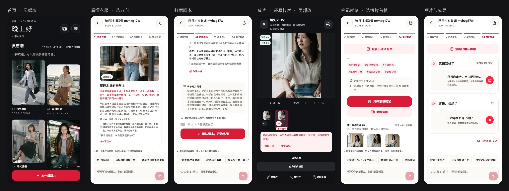

# 衣序 · 穿搭笔记智能体

小红书穿搭博主接到品牌合作，品牌方往往只给几张衣服图。博主在「衣序」里和智能体多轮对话：看懂衣服、定方向和整套搭配、写脚本，确认后批量出"博主 × 衣服 × 场景"的成片，一句话改图，最后得到一篇可直接发布的图文笔记和一条短视频。赶更新时切到「一键出片」，全套自动出好，中途随时接手。



- 线上服务：`https://47.97.153.127:8443`
- App：iPhone 真机 Release 包已安装；iOS / Android / Web 同一套代码
- 管理端：`/admin`（模型切换、配额、用量、任务队列）

## 交付材料

| | 看什么 | 在哪 |
|---|---|---|
| 1 | **文档**：功能清单、场景与调研、生成能力实测、框架选型、下一步规划、设计约定、UI 设计稿、设计系统 | [docs/功能清单.md](docs/功能清单.md) · [docs/调研.md](docs/调研.md) · [docs/调研-Chiccify对照.md](docs/调研-Chiccify对照.md) · [docs/规划-模特库与人像一致性.md](docs/规划-模特库与人像一致性.md) · [docs/设计.md](docs/设计.md) · [docs/UI设计稿.md](docs/UI设计稿.md) · [docs/设计系统.md](docs/设计系统.md) |
| 2 | **开发记录与卡点**：从接到作业到交付的完整时间线，每个卡点怎么定位、怎么解 | [docs/开发记录.md](docs/开发记录.md) |
| 3 | **开发感受** | [docs/开发感受.md](docs/开发感受.md) |
| 4 | **代码**：服务端、App、管理端，以及验收证据与部署 | [server/](server/) · [app/](app/) · [docs/验收与部署.md](docs/验收与部署.md) |

全部文档的 HTML 阅读版（带目录与流程图）：[docs/html/index.html](docs/html/index.html)。

## 技术栈

```
App（Expo / React Native / TypeScript）──HTTPS：REST + SSE──▶ FastAPI
                                                                │
                                              LangGraph 智能体（Postgres checkpointer，thread = 项目）
                                              阶段之间：状态机（代码管钱、可审计）
                                              阶段之内：ReAct（模型选工具、写回复）
                                                                │
                                              PostgreSQL（业务表 + 任务队列 + checkpoint）
                                                                ▲
                                              Worker × 2（SKIP LOCKED 领任务）
                                                ├─ 豆包 Seedream 5.0 pro / wan2.7：出图、改图（管理端可切）
                                                ├─ qwen3-vl-plus：看图、还原核对
                                                ├─ wan2.6-i2v：图生视频
                                                └─ DeepSeek：对话、脚本、笔记
```

| 层 | 技术 |
|---|---|
| 服务端 | Python · FastAPI · LangGraph 1.x · SQLAlchemy / Alembic · PostgreSQL 16 · Pillow · ffmpeg · Docker Compose · nginx + TLS |
| App | Expo SDK 58 · React Native 0.88 · expo-router · 自建设计系统（DTCG token，lint 禁止裸色值） · Playwright 端到端 |
| 管理端 | 服务端托管的轻量 HTML 页面，与 App 共用设计 token，无前端运行时依赖，独立交互回归 |
| 工程 | GitHub Actions · pre-commit 钩子 · Makefile · ruff / ESLint；服务端历史覆盖率 91.09%，口径见[工程规范快照](docs/工程规范.md#初次落地质量快照历史) |

## 怎么跑

需要 Node 22.13 或以上。以下每组命令均从仓库根目录执行，长期运行的进程分别使用不同终端。

```bash
# 终端一：App 假服务（不需要启动 Python 服务端）
cd app
npm ci
npm run mock
```

```bash
# 终端二：Web App，显式连接本机假服务
cd app
EXPO_PUBLIC_API_BASE=http://localhost:19301 npm run web
```

App 如果已在设置里保存其他服务地址，需同步改为 `http://localhost:19301`；手机连接方式见 [App README](app/README.md#本地启动)。

```bash
# 可选：运行真实服务端链路，模型仍使用 Mock
cd server
MOCK_PROVIDERS=1 docker compose up -d --build
```

服务端地址与环境准备见 [服务端 README](server/README.md#本地启动)；连接该服务端时相应调整 App 服务地址。

```bash
# 仓库根目录：检查与文档生成
make check        # 服务端 ruff + pytest，App 八项校验
make docs         # 重新生成 docs/html
```

## 工作方式

调研与实测 → 设计先行（契约、UI 设计稿、设计 token）→ 工程底座（CI、假服务、迁移与部署）→ 按设计还原主链路并在线上留证据 → 产品完整度与质量 → 独立评审、修复、最终回归。

整个过程以 AI 原生方式协作：我定方向、拍板与验收，Claude 负责调研、契约、评审与复测合并，Codex 按任务书并行实现。分工与每一轮的细节在 [docs/开发记录.md](docs/开发记录.md)。
