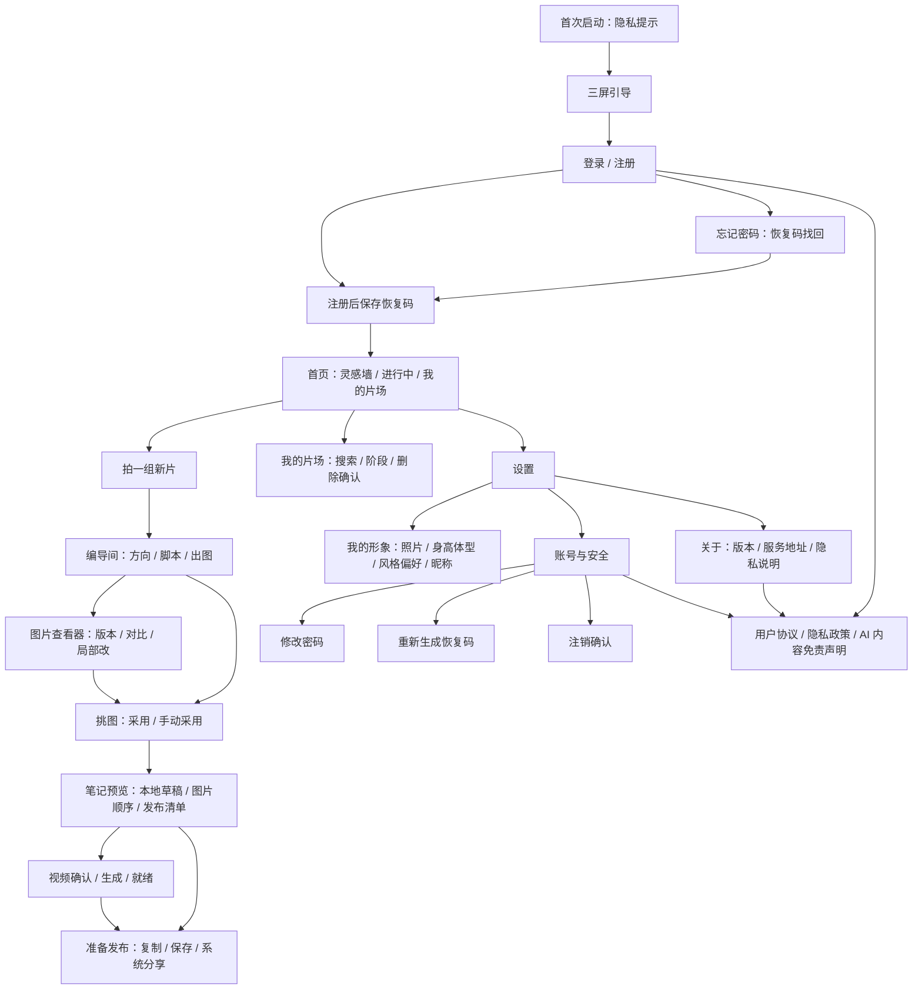
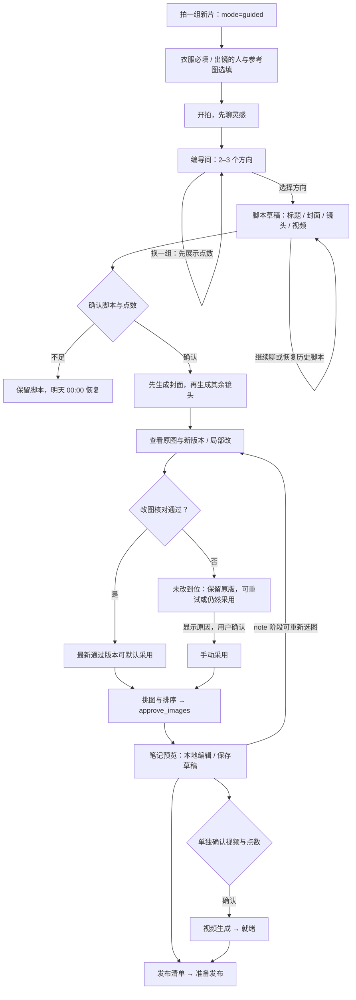
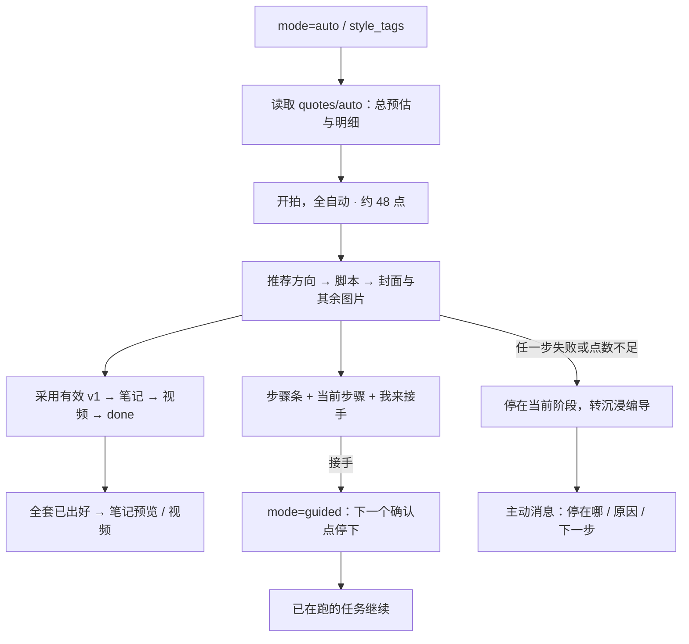
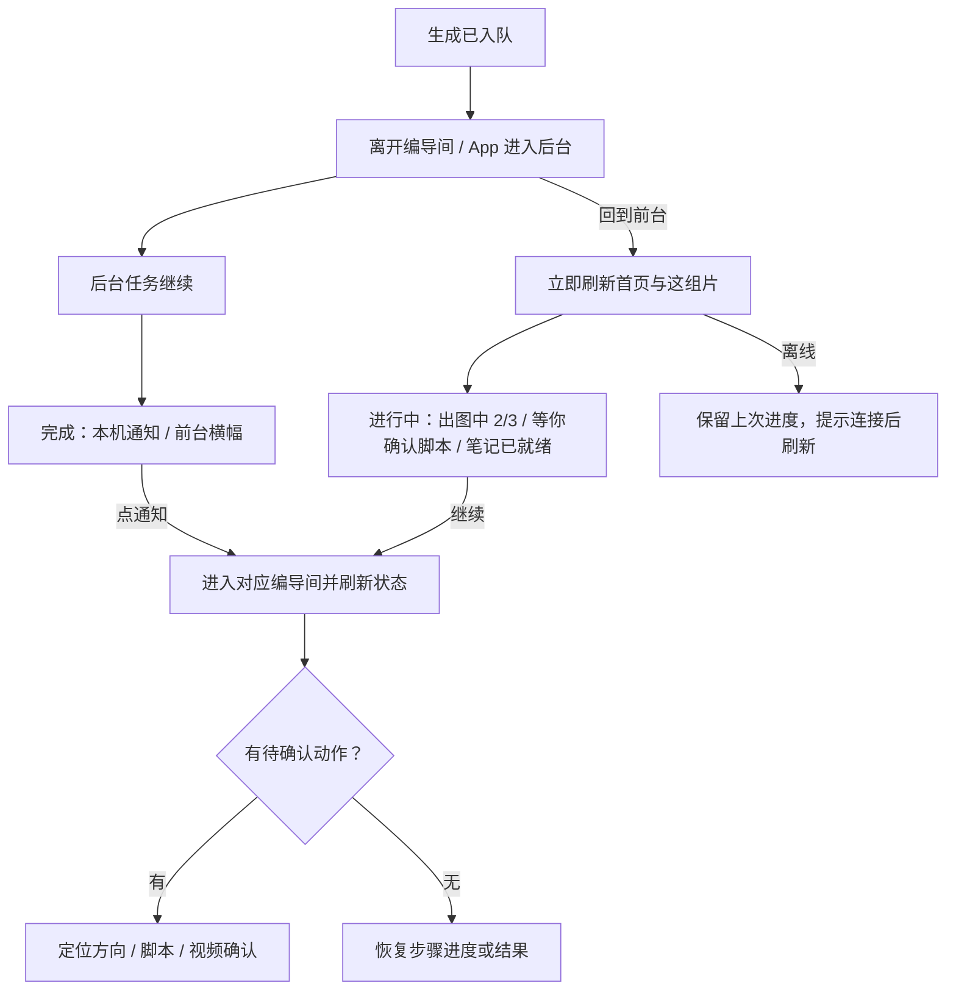
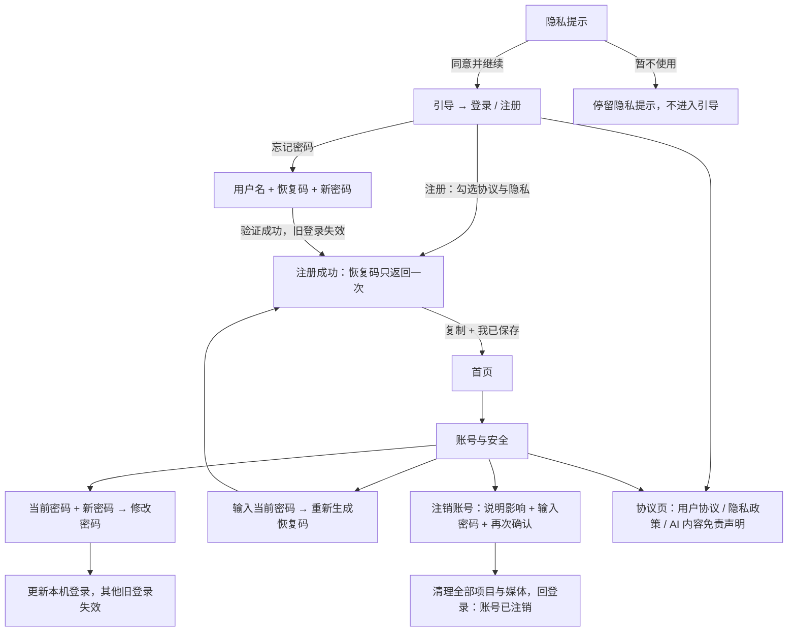

# 衣序 · UI 设计稿

这是「先设计、后实现」的评审与开发依据。[高保真设计板](design/index.html)按首次进入、开拍、编导、挑图发布、账号管理排列；每个手机画布为 390 × 844。数据、动作与范围遵循 [设计契约](设计.md) §1.1、§8、§10–§16，接口变化仍先回到契约。设计板展示规划中的完整产品，不代表所有页面已经在 App 落地。

## 1. 设计目标与原则

- **片场是暗的，编辑桌是亮的。** 灵感、登录、引导与开拍用 `studio`；编导间、笔记预览与账号表单用 `paper`。图片查看器保持深色，让衣服与细节先被看见。
- **一次只问一个问题。** 沉浸编导依次定方向、定脚本、挑图片、定视频。当前需要的动作贴着内容出现；一键出片只报告当前步骤，保留「我来接手」。
- **花钱前先说清。** 用户界面统一以点数表达；正式出图与视频分别确认。一键出片在开拍时说明完整预估和自动推进范围；换一组方向、改图和重试也显示预估。
- **错误要能恢复。** 保留输入、原图、版本链、已完成镜头与本地草稿。网络重发复用同一次提交；「再试一次」才建立新尝试；未改到位的新版本不自动入稿。
- **用户只看点数。** 主按钮显示本次预估，辅助文案显示今日可用点数；不足时明确恢复时间，不引入充值或订阅入口。

## 2. 信息架构

产品页面与内部字段分别命名：面向用户使用「我的片场」「这组片」「编导间」「出镜的人」；文档中的 `project`、`image`、`note` 等仅用于开发映射。没有手机号验证、支付、自动发布、社交互动或用户侧组件画廊。

| 分区 | 页面与主要出口 | 约束 |
|---|---|---|
| 首次进入 | 隐私提示 → 引导 1–3 → 登录 / 注册 → 恢复码 | 同意隐私提示后才进入引导；注册同意勾选独立记录；恢复码只展示一次 |
| 片场 | 首页、拍一组新片、我的片场 | 灵感图片可查看；进行中优先恢复；素材为衣服、出镜的人、参考图三张卡 |
| 编辑桌 | 编导间、图片查看器、挑图、笔记预览、视频 | 沉浸编导逐项确认；一键出片可接手；保留版本和检查结果 |
| 个人与账号 | 设置、我的形象、账号与安全、修改密码、恢复码、忘记密码、注销、关于、协议页 | 仅用户名与密码；注销为二次确认；旧服务不支持的新增入口隐藏 |

### 2.1 沉浸编导

### 2.2 一键出片

一键出片的自动推进授权集中在开拍按钮及其上方说明，进行中不显示方向、脚本或视频确认按钮。「我来接手」不会取消在跑的任务，也不承诺立即停机。

### 2.3 离开再回来与通知

首页有 `generating` 时每 5 秒刷新，进入编导间有 `active_jobs` 时每 3 秒读状态；显示已完成数量，不伪造百分比或预计剩余秒数。通知未授权不阻塞生成，仍可回首页继续。

### 2.4 账号闭环

账号找回统一提示「账号或恢复码不正确，请核对后重试」，不分别透露账号是否存在。恢复成功和重新生成恢复码后，都要求保存新码；旧码失效。注销失败留在确认页，不清除本地输入之外的账号状态。

## 3. 视觉语言

### 3.1 双主题与色板

语义命名对应 §16.1：`color.brand.primary` → `--color-brand-primary` → Figma `Brand/Primary`。当前可读取的样式依据为 `app/src/theme.ts`；下表是设计交付的语义映射，未来由 `app/design/tokens.json` 生成实现，不宣称该流水线已落地。设计板内嵌全部 CSS，两个主题覆盖同名变量。

| Token / CSS 变量 | paper · 浅色编辑桌 | studio · 深色片场 | 用途 |
|---|---|---|---|
| `color.brand.primary` / `--color-brand-primary` | `#FF2442` | `#FF2442` | 品牌符号、进度、选中边缘 |
| `color.brand.action` / `--color-brand-action` | `#D91B38` | `#D91B38` | 主操作背景，白字 |
| `color.text.primary` / `--color-text-primary` | `#252522` | `#FCFAF7` | 标题与正文 |
| `color.text.secondary` / `--color-text-secondary` | `#6D6963` | `#BBBFC8` | 说明、时间与非主信息 |
| `color.text.brand` / `--color-text-brand` | `#C51D39` | `#FF8192` | 文本链接、选中标签 |
| `color.bg.page` / `--color-bg-page` | `#FCFAF7` | `#111215` | 页面背景 |
| `color.bg.surface` / `--color-bg-surface` | `#FFFFFF` | `#24262C` | 卡片与浮层 |
| `color.bg.subtle` / `--color-bg-subtle` | `#F2EEE8` | `#17191D` | 输入、次级承载面 |
| `color.border.default` / `--color-border-default` | `#E9E5DE` | `#3D4048` | 细分隔线，不独立承担表单边界 |
| `color.border.input` / `--color-border-input` | `#8E8780` | `#888D99` | 输入与选择控件边界 |
| `color.status.success` / `--color-status-success` | `#32684E` | `#9FD9B5` | 已完成、已采用 |
| `color.status.warning` / `--color-status-warning` | `#825116` | `#E9BD81` | 未改到位、手动采用 |
| `color.status.danger` / `--color-status-danger` | `#B42338` | `#FF9CA8` | 错误、注销说明 |
| `color.overlay.scrim` / `--color-overlay-scrim` | `rgba(24,22,20,.48)` | 同左 | Sheet 遮罩 |
| `color.mask` / `--color-mask` | `#FF244255` | 同左 | 涂抹轨迹；同时显示选区边界 |

品牌红只强调选择与动作，不铺满大面积背景。状态通过图标、文字与颜色共同表达。设计板默认按页面角色取主题；顶部「全部浅色 / 全部深色」用于评审同一套语义变量，图片查看器保持深色。该工具只切换视觉，不模拟真实提交。

### 3.2 字体、字号与排版

展示级标题用 `Songti SC` 细体、2px 字距；系统缺少该字体时使用系统衬线，Android 实现遵循 §14.5 使用系统字体。正文为 `-apple-system / BlinkMacSystemFont / PingFang SC / sans-serif`，无在线字体。数字进度与恢复码使用系统等宽字体。

| Token | 字号 / 行高 | 字重与用途 |
|---|---|---|
| `type.brand` | 36 / 44 | 展示标题，宋体细体；标志可用 800 |
| `type.title` | 28 / 36 | 700，页面标题 |
| `type.heading` | 20 / 28 | 700，分区标题 |
| `type.subtitle` | 16 / 24 | 600，卡片标题 |
| `type.body` | 15 / 24 | 400，主要内容 |
| `type.reading` | 15 / 28 | 400，协议和长文 |
| `type.label` | 13 / 20 | 600，字段与操作说明 |
| `type.caption` | 12 / 18 | 400，辅助信息 |
| `type.badge` | 11 / 16 | 600，图片状态和 AI 标识 |
| `type.button` | 15 / 22 | 700，动作 |

### 3.3 尺寸与图片

| 组 | Token 与值 | 规则 |
|---|---|---|
| 间距 | `space.xs / sm / md / lg / xl / xxl` = 4 / 8 / 12 / 16 / 24 / 32 | 对应 `--space-xs` 等；页面左右 24，卡内 16，卡间 12，分区间 24–32 |
| 圆角 | `radius.sm / md / lg` = 12 / 16 / 20 | 输入 12，按钮与卡片 16，图片容器与 Sheet 20；词条为胶囊 |
| 布局 | `layout.touch` = 44；`layout.maxWidth` = 520 | 手机画布 390 × 844；按钮高 52；所有图标、返回、词条与内联动作最小触控 44 |
| 图片 | `layout.thumbnailRatio` = 3/4 | 灵感、方向、挑图缩略图使用 3:4；完整查看器 `object-fit: contain`，不得裁掉原图 AI 标识；封面锚点明确标注 |
| 安全区 | 顶部 44，底部 24 | 底部固定主操作不盖住滚动内容；键盘弹出后内容仍可滚动 |

生成图右下角保留可见「AI生成」标识（素材已带原始标识），缩略图覆盖裁切时补一枚同文案角标；原图只显示原标识。查看器左上或图下承载「未改到位」，不遮衣服关键细节；发布预览与清单保留「AI 生成内容」声明及「手动采用」。灵感素材仅作成片示意，不当作用户本人照片或上传衣服原图。

### 3.4 动效

`motion.fast / normal / slow / pulse` = 160 / 240 / 360 / 1200ms：按下反馈、卡片进入、Sheet 出入、加载占位。主按钮按下缩至 .975；导航淡入并位移不超过 8px。生成进度来自真实任务数量；不确定阶段用文字和短进度条，不制造进度百分比。减少动态效果开启时取消位移、缩放与脉冲，保留即时状态更新。设计板为静态定格，主题切换仅 160ms；截图时关闭动画。
