# 衣序 · UI 设计稿

这是「先设计、后实现」的评审与开发依据。[高保真设计板](design/index.html)按首次进入、开拍、编导、挑图发布、账号管理排列；每个手机画布为 390 × 844。数据、动作与范围遵循 [设计契约](设计.md) §1.1、§8、§10–§16，接口变化仍先回到契约。设计板展示规划中的完整产品，不代表所有页面已经在 App 落地。

## 1. 设计目标与原则

- **片场是暗的，编辑桌是亮的。** 灵感、登录、引导与开拍用 `studio`；编导间、笔记预览与账号表单用 `paper`。图片查看器保持深色，让衣服与细节先被看见。
- **一次只问一个问题。** 沉浸编导依次定方向、定脚本、挑图片、定视频。当前需要的动作贴着内容出现；一键出片只报告当前步骤，保留「我来接手」。
- **花钱前先说清。** 用户界面统一以点数表达；正式出图与视频分别确认。一键出片在开拍时说明完整预估和自动推进范围；换一组方向、改图和重试也显示预估。
- **错误要能恢复。** 保留输入、原图、版本链、已完成镜头与本地草稿。改图传输重试复用同一 attempt，普通写请求不自动重放；「再试一次」才建立新尝试；未改到位的新版本不自动入稿。
- **用户只看点数。** 主按钮显示本次预估，辅助文案显示今日可用点数；不足时明确恢复时间，不引入充值或订阅入口。

## 2. 信息架构

产品页面与内部字段分别命名：面向用户使用「我的片场」「这组片」「编导间」「出镜的人」；文档中的 `project`、`image`、`note` 等仅用于开发映射。没有手机号验证、支付、自动发布、社交互动或用户侧组件画廊。

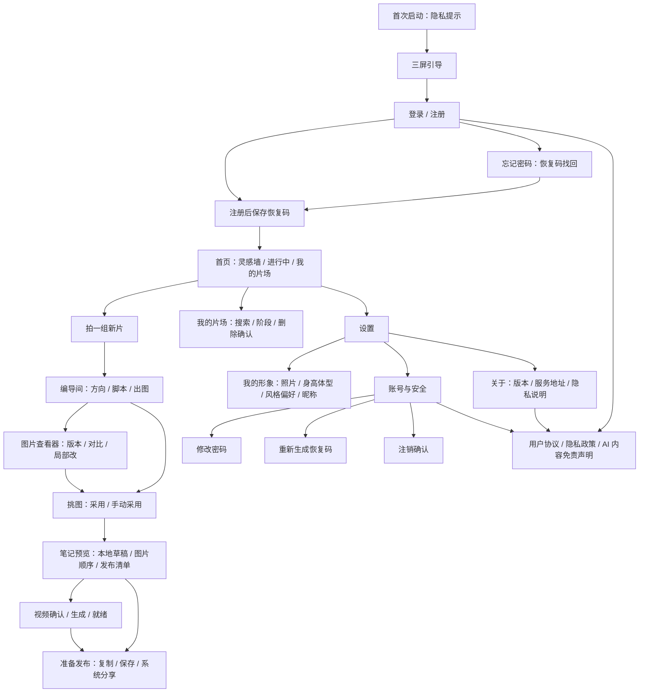

| 分区 | 页面与主要出口 | 约束 |
|---|---|---|
| 首次进入 | 隐私提示 → 引导 1–3 → 登录 / 注册 → 恢复码 | 同意隐私提示后才进入引导；注册同意勾选独立记录；恢复码只展示一次 |
| 片场 | 首页、拍一组新片、我的片场 | 灵感图片可查看；进行中优先恢复；素材为衣服、出镜的人、参考图三张卡 |
| 编辑桌 | 编导间、图片查看器、挑图、笔记预览、视频 | 沉浸编导逐项确认；一键出片可接手；保留版本和检查结果 |
| 个人与账号 | 设置、我的形象、账号与安全、修改密码、恢复码、忘记密码、注销、关于、协议页 | 仅用户名与密码；注销为二次确认；旧服务不支持的新增入口隐藏 |

### 2.1 沉浸编导

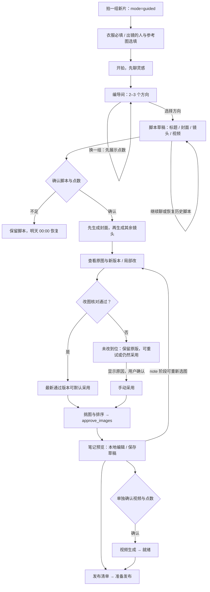

### 2.2 一键出片

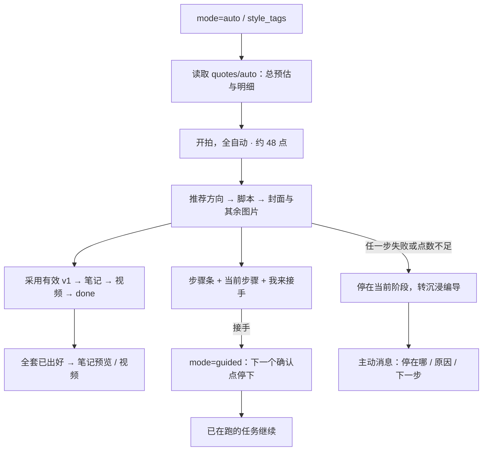

一键出片的自动推进授权集中在开拍按钮及其上方说明，进行中不显示方向、脚本或视频确认按钮。「我来接手」不会取消在跑的任务，也不承诺立即停机。

### 2.3 离开再回来与通知

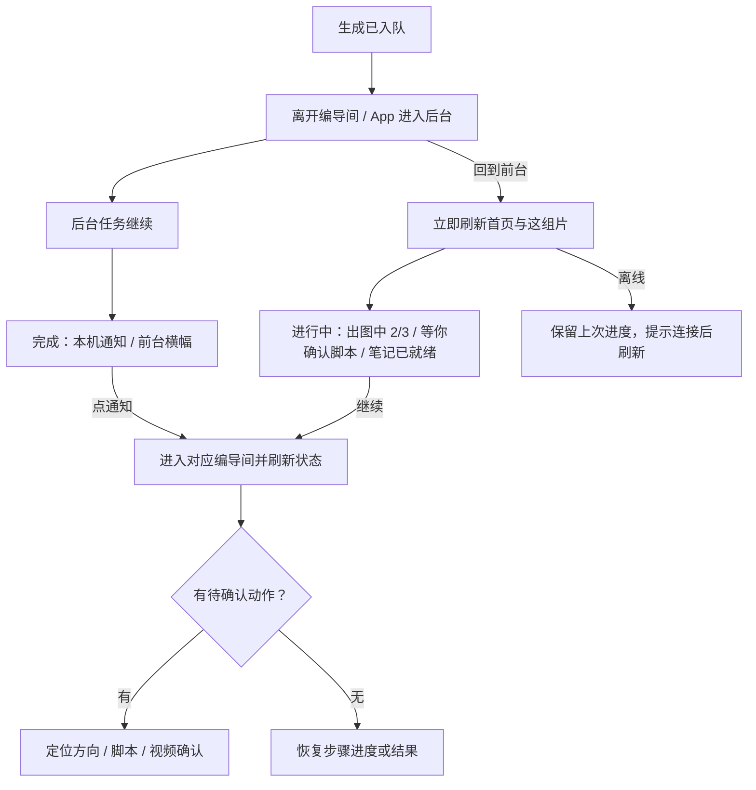

首页有 `generating` 时每 5 秒刷新，进入编导间有 `active_jobs` 时每 3 秒读状态；显示已完成数量，不伪造百分比或预计剩余秒数。通知未授权不阻塞生成，仍可回首页继续。

### 2.4 账号闭环

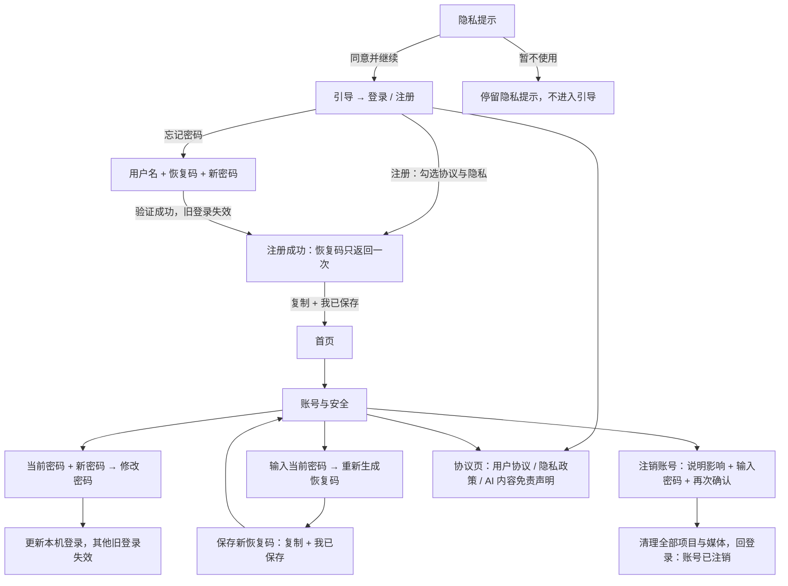

账号找回统一提示「账号或恢复码不正确，请核对后重试」，不分别透露账号是否存在。恢复成功和重新生成恢复码后，都要求保存新码；旧码失效。注销失败留在确认页，不清除本地输入之外的账号状态。

## 3. 视觉语言

### 3.1 双主题与色板

语义命名对应 §16.1：`color.brand.primary` → `--color-brand-primary` → Figma `Brand/Primary`。当前可读取的样式依据为 `app/src/theme.ts`；下表是设计交付的语义映射，未来由 `app/design/tokens.json` 生成实现，不宣称该流水线已落地。设计板内嵌全部 CSS，两个主题覆盖同名变量。

| Token / CSS 变量 | paper · 浅色编辑桌 | studio · 深色片场 | 用途 |
|---|---|---|---|
| `color.brand.primary` / `--color-brand-primary` | `#FF2442` | `#FF2442` | 品牌符号、进度、选中边缘 |
| `color.brand.action` / `--color-brand-action` | `#D91B38` | `#D91B38` | 主操作背景，白字 |
| `color.text.primary` / `--color-text-primary` | `#252522` | `#FCFAF7` | 标题与正文 |
| `color.text.secondary` / `--color-text-secondary` | `#6D6963` | `#BBBFC8` | 说明、时间与非主信息 |
| `color.text.brand` / `--color-text-brand` | `#C51D39` | `#FF8192` | 文本链接、选中标签 |
| `color.bg.page` / `--color-bg-page` | `#FCFAF7` | `#111215` | 页面背景 |
| `color.bg.surface` / `--color-bg-surface` | `#FFFFFF` | `#24262C` | 卡片与浮层 |
| `color.bg.subtle` / `--color-bg-subtle` | `#F2EEE8` | `#17191D` | 输入、次级承载面 |
| `color.border.default` / `--color-border-default` | `#E9E5DE` | `#3D4048` | 细分隔线，不独立承担表单边界 |
| `color.border.input` / `--color-border-input` | `#8E8780` | `#888D99` | 输入与选择控件边界 |
| `color.status.success` / `--color-status-success` | `#32684E` | `#9FD9B5` | 已完成、已采用 |
| `color.status.warning` / `--color-status-warning` | `#825116` | `#E9BD81` | 未改到位、手动采用 |
| `color.status.danger` / `--color-status-danger` | `#B42338` | `#FF9CA8` | 错误、注销说明 |
| `color.overlay.scrim` / `--color-overlay-scrim` | `rgba(24,22,20,.48)` | 同左 | Sheet 遮罩 |
| `color.mask` / `--color-mask` | `#FF244255` | 同左 | 涂抹轨迹；同时显示选区边界 |

品牌红只强调选择与动作，不铺满大面积背景。状态通过图标、文字与颜色共同表达。设计板默认按页面角色取主题；顶部「全部浅色 / 全部深色」用于评审同一套语义变量，图片查看器保持深色。该工具只切换视觉，不模拟真实提交。

### 3.2 字体、字号与排版

展示级标题用 `Songti SC` 细体、2px 字距；系统缺少该字体时使用系统衬线，Android 实现遵循 §14.5 使用系统字体。正文为 `-apple-system / BlinkMacSystemFont / PingFang SC / sans-serif`，无在线字体。数字进度与恢复码使用系统等宽字体。

| Token | 字号 / 行高 | 字重与用途 |
|---|---|---|
| `type.brand` | 36 / 44 | 展示标题，宋体细体；标志可用 800 |
| `type.title` | 28 / 36 | 700，页面标题 |
| `type.heading` | 20 / 28 | 700，分区标题 |
| `type.subtitle` | 16 / 24 | 600，卡片标题 |
| `type.body` | 15 / 24 | 400，主要内容 |
| `type.reading` | 15 / 28 | 400，协议和长文 |
| `type.label` | 13 / 20 | 600，字段与操作说明 |
| `type.caption` | 12 / 18 | 400，辅助信息 |
| `type.badge` | 11 / 16 | 600，图片状态和 AI 标识 |
| `type.button` | 15 / 22 | 700，动作 |

### 3.3 尺寸与图片

| 组 | Token 与值 | 规则 |
|---|---|---|
| 间距 | `space.xs / sm / md / lg / xl / xxl` = 4 / 8 / 12 / 16 / 24 / 32 | 对应 `--space-xs` 等；页面左右 24，卡内 16，卡间 12，分区间 24–32 |
| 圆角 | `radius.sm / md / lg` = 12 / 16 / 20 | 输入 12，按钮与卡片 16，图片容器与 Sheet 20；词条为胶囊 |
| 布局 | `layout.touch` = 44；`layout.maxWidth` = 520 | 手机画布 390 × 844；按钮高 52；所有图标、返回、词条与内联动作最小触控 44 |
| 图片 | `layout.thumbnailRatio` = 3/4 | 灵感、方向、挑图缩略图使用 3:4；完整查看器 `object-fit: contain`，不得裁掉原图 AI 标识；封面锚点明确标注 |
| 安全区 | 顶部 44，底部 24 | 底部固定主操作不盖住滚动内容；键盘弹出后内容仍可滚动 |

生成图右下角保留可见「AI生成」标识（素材已带原始标识），缩略图覆盖裁切时补一枚同文案角标；原图只显示原标识。查看器左上或图下承载「未改到位」，不遮衣服关键细节；发布预览与清单保留「AI 生成内容」声明及「手动采用」。灵感素材仅作成片示意，不当作用户本人照片或上传衣服原图。

### 3.4 动效

`motion.fast / normal / slow / pulse` = 160 / 240 / 360 / 1200ms：按下反馈、卡片进入、Sheet 出入、加载占位。主按钮按下缩至 .975；导航淡入并位移不超过 8px。生成进度来自真实任务数量；不确定阶段用文字和短进度条，不制造进度百分比。减少动态效果开启时取消位移、缩放与脉冲，保留即时状态更新。设计板为静态定格，主题切换仅 160ms；截图时关闭动画。

<!-- pages:start -->
## 4. 页面设计

以下 35 节与设计板画布一一对应。配图是设计定格，按钮、选区与播放条用于评审布局；浏览器可滚动长内容，只有顶部主题预览可交互。每节列出空、加载、错误、成功、点数不足；不扣点的页面明确写出不适用，避免为了凑状态引入功能。旁注只摘录关键变体，完整处理以下表为准。

主题切换对照：[首页的 paper 预览](design/shots/theme-paper.png)、[编导间的 studio 预览](design/shots/theme-studio.png)。[浏览器检查记录](design/verification.json)与[复现方式](design/README.md)随稿交付。

### 4.1 隐私提示

**目标：** 在首次引导前说明资料用途，由用户决定是否继续。

**布局：** studio 主题；上方两张灵感成片拼贴；品牌引语、隐私提示与资料用途说明；协议文字入口；底部同意并继续与暂不使用。

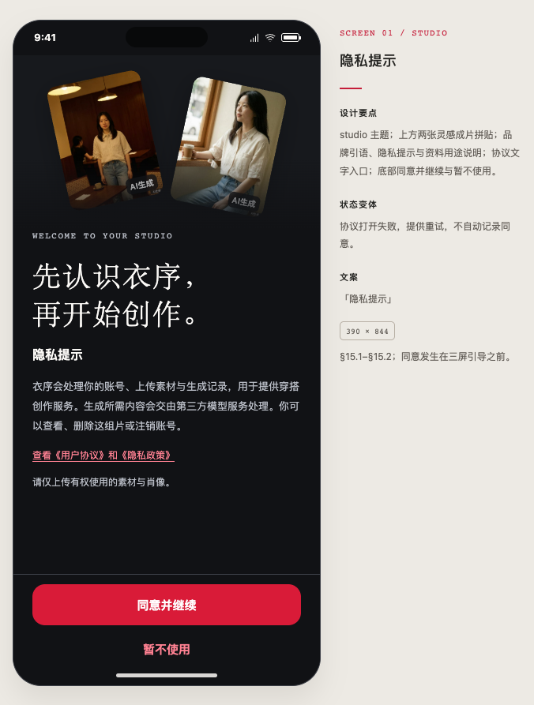

| 状态 | 设计处理 |
|---|---|
| 空 | 首次启动尚未同意，停留此页。 |
| 加载 | 协议内容加载中，保留同意与退出的上下文。 |
| 错误 | 协议打开失败，提供重试，不自动记录同意。 |
| 成功 | 同意并继续后进入第一屏引导；暂不使用则不进入创作流程。 |
| 点数不足 | 此页不扣点，不显示点数门槛。 |

**文案口径：** 「隐私提示」；「先认识衣序，再开始创作。」；「查看《用户协议》和《隐私政策》」；「请仅上传有权使用的素材与肖像。」；「同意并继续」；「暂不使用」。

**契约映射：** §15.1–§15.2；同意发生在三屏引导之前。

### 4.2 引导·一件衣服

**目标：** 用完整成片示例解释从衣服到图文和视频的主链路。

**布局：** studio 主题；大幅灵感成片与深色渐变；示例编号及 AI 生成标识；底部展示标题、说明、三步指示与继续按钮。

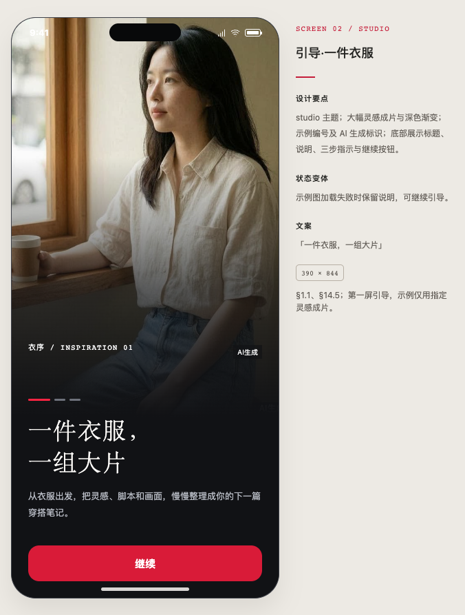

| 状态 | 设计处理 |
|---|---|
| 空 | 首次进入第一屏，示例不代表用户本人照片。 |
| 加载 | 示例图未就绪时显示固定比例占位，标题与按钮保持可见。 |
| 错误 | 示例图加载失败时保留说明，可继续引导。 |
| 成功 | 继续进入两种模式说明。 |
| 点数不足 | 引导不扣点，不显示点数不足提示。 |

**文案口径：** 「一件衣服，一组大片」；「从衣服出发，把灵感、脚本和画面，慢慢整理成你的下一篇穿搭笔记。」；「AI生成」；「继续」。

**契约映射：** §1.1、§14.5；第一屏引导，示例仅用指定灵感成片。

### 4.3 引导·两种模式

**目标：** 让用户理解一键出片与沉浸编导的选择。

**布局：** studio 主题；大幅灵感成片、示例编号与 AI 标识；底部用一段话解释两种模式；第二步指示与继续按钮。

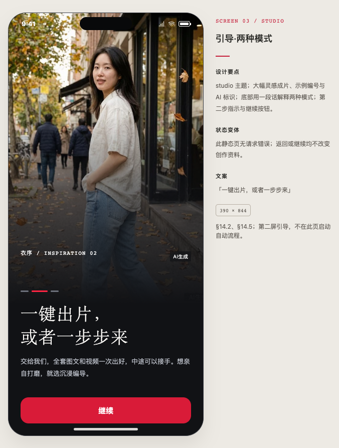

| 状态 | 设计处理 |
|---|---|
| 空 | 尚未选择创作模式，此页只解释，不创建这组片。 |
| 加载 | 静态内容直接呈现，无需等待远端结果。 |
| 错误 | 此静态页无请求错误；返回或继续均不改变创作资料。 |
| 成功 | 继续进入点数确认说明，实际模式在拍一组新片页选择。 |
| 点数不足 | 模式说明不扣点，不阻断阅读。 |

**文案口径：** 「一键出片，或者一步步来」；「交给我们，全套图文和视频一次出好，中途可以接手。想亲自打磨，就选沉浸编导。」；「继续」。

**契约映射：** §14.2、§14.5；第二屏引导，不在此页启动自动流程。

### 4.4 引导·点数确认

**目标：** 说明扣点授权、AI 标识与生成结果需要核对。

**布局：** studio 主题；大幅灵感成片和 AI 标识；底部说明两种模式的扣点授权及发布声明；第三步指示与进入衣序按钮。

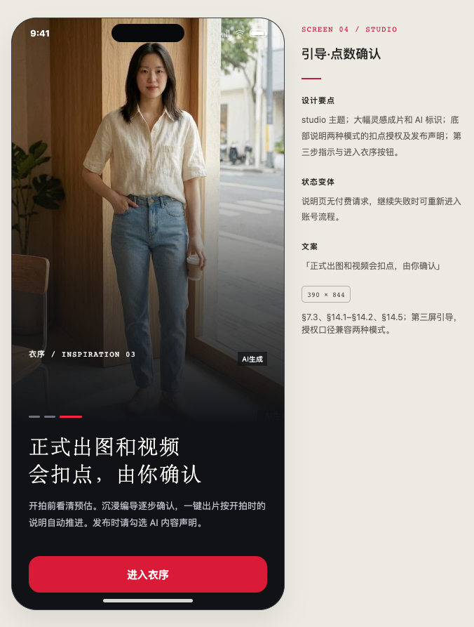

| 状态 | 设计处理 |
|---|---|
| 空 | 尚未开始创作，不显示实际扣点记录。 |
| 加载 | 本屏为静态说明，不模拟生成任务。 |
| 错误 | 说明页无付费请求，继续失败时可重新进入账号流程。 |
| 成功 | 结束引导，进入登录或注册。 |
| 点数不足 | 引导不扣点；真实操作不足时再提示明日恢复。 |

**文案口径：** 「正式出图和视频会扣点，由你确认」；「开拍前看清预估。沉浸编导逐步确认，一键出片按开拍时的说明自动推进。发布时请勾选 AI 内容声明。」；「进入衣序」。

**契约映射：** §7.3、§14.1–§14.2、§14.5；第三屏引导，授权口径兼容两种模式。

### 4.5 登录

**目标：** 用用户名和密码返回自己的片场。

**布局：** studio 主题；衣序品牌与展示标题；登录/注册切换；用户名、密码；忘记密码入口、登录按钮与三类协议页脚。

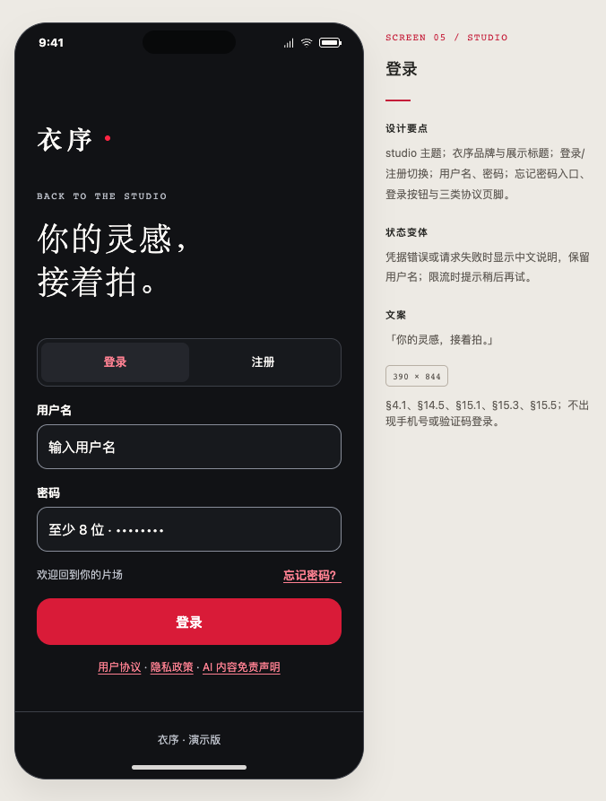

| 状态 | 设计处理 |
|---|---|
| 空 | 用户名或密码为空时提示补全，不提交。 |
| 加载 | 登录按钮显示正在登录并防止重复提交。 |
| 错误 | 凭据错误或请求失败时显示中文说明，保留用户名；限流时提示稍后再试。 |
| 成功 | 登录成功进入首页；注销返回时显示账号已注销。 |
| 点数不足 | 登录不扣点，点数不足不影响进入账号。 |

**文案口径：** 「你的灵感，接着拍。」；「登录」；「注册」；「用户名」；「密码」；「欢迎回到你的片场」；「忘记密码？」；「用户协议」；「隐私政策」；「AI 内容免责声明」。

**契约映射：** §4.1、§14.5、§15.1、§15.3、§15.5；不出现手机号或验证码登录。

### 4.6 注册

**目标：** 完成用户名注册并取得明确的协议同意。

**布局：** studio 主题；衣序品牌与标题；注册选中；用户名、密码和昵称选填；未勾选的协议控件及提示；注册按钮置灰；保存恢复码提示。

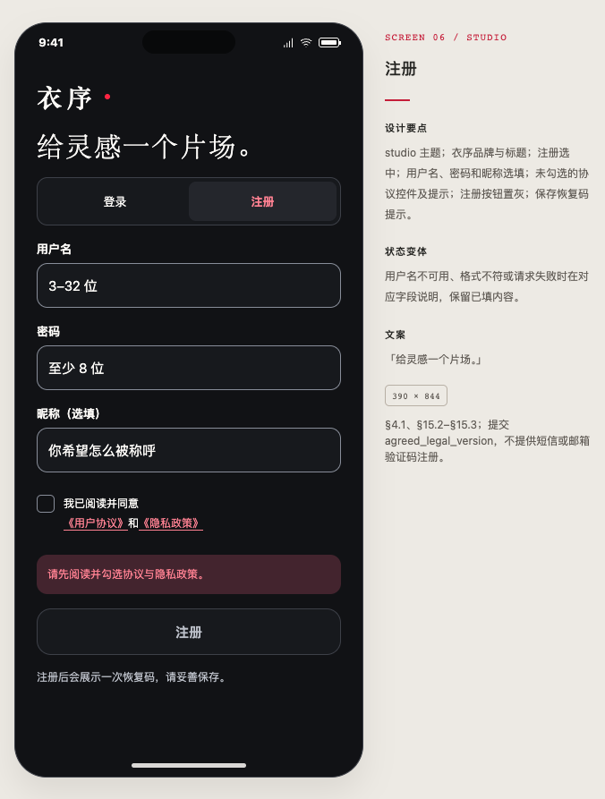

| 状态 | 设计处理 |
|---|---|
| 空 | 用户名、密码未填或协议未勾选时按钮置灰，提示原因。 |
| 加载 | 注册中防止重复提交，不提前进入首页。 |
| 错误 | 用户名不可用、格式不符或请求失败时在对应字段说明，保留已填内容。 |
| 成功 | 注册成功先进入整页保存恢复码，不直接跳过。 |
| 点数不足 | 注册不扣点，不设置点数条件。 |

**文案口径：** 「给灵感一个片场。」；「用户名」；「3–32 位」；「密码」；「至少 8 位」；「昵称（选填）」；「我已阅读并同意《用户协议》和《隐私政策》」；「请先阅读并勾选协议与隐私政策。」；「注册」。

**契约映射：** §4.1、§15.2–§15.3；提交 agreed_legal_version，不提供短信或邮箱验证码注册。

### 4.7 保存恢复码

**目标：** 确保用户保存唯一的密码找回凭据。

**布局：** paper 主题整页；钥匙图标与唯一找回方式说明；DEMO-ONLY-CODE 设计占位及真实格式提示；复制恢复码、已复制反馈；底部我已保存。

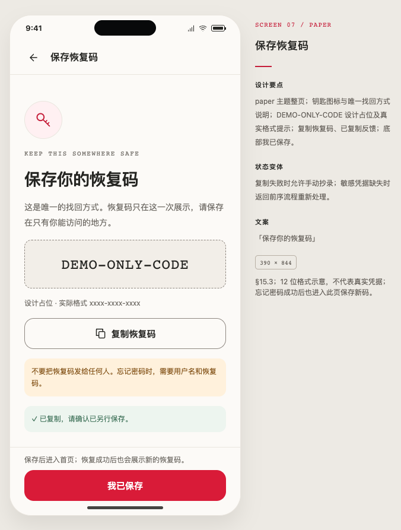

| 状态 | 设计处理 |
|---|---|
| 空 | 恢复码未返回时不显示伪造凭据，也不假装完成保存。 |
| 加载 | 等待注册或恢复完成的响应，保留前序页面状态。 |
| 错误 | 复制失败时允许手动抄录；敏感凭据缺失时返回前序流程重新处理。 |
| 成功 | 复制后提示已复制；只有点击我已保存才进入首页。 |
| 点数不足 | 保存恢复码不扣点。 |

**文案口径：** 「保存你的恢复码」；「这是唯一的找回方式。恢复码只在这一次展示，请保存在只有你能访问的地方。」；「DEMO-ONLY-CODE」；「设计占位 · 实际格式 xxxx-xxxx-xxxx」；「复制恢复码」；「已复制，请确认已另行保存。」；「我已保存」。

**契约映射：** §15.3；12 位格式示意，不代表真实凭据；忘记密码成功后也进入此页保存新码。

### 4.8 首页

**目标：** 用灵感激发开拍，并让未完成的片场随时可接续。

**布局：** studio 主题；顶部品牌与设置；两列瀑布灵感墙；刚刚出好提示；进行中卡片含 2/3 进度与继续；我的片场摘要；底部拍一组新片。

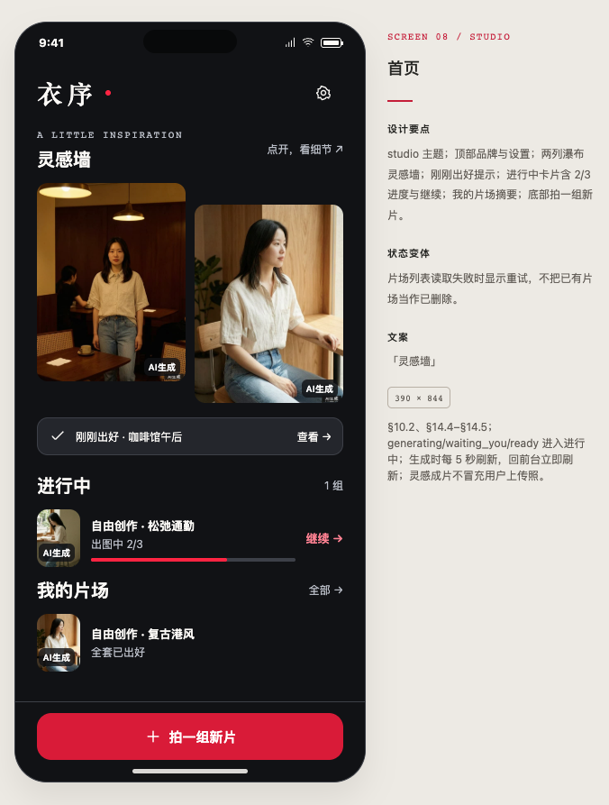

| 状态 | 设计处理 |
|---|---|
| 空 | 没有片场时保留灵感墙，并引导拍一组新片。 |
| 加载 | 列表显示骨架；已有卡片继续可见，下拉刷新不清空内容。 |
| 错误 | 片场列表读取失败时显示重试，不把已有片场当作已删除。 |
| 成功 | 进行中置顶；刚刚出好或继续均打开对应编导间。 |
| 点数不足 | 浏览首页不扣点；剩余点数不足不阻止查看已有内容。 |

**文案口径：** 「灵感墙」；「点开，看细节 ↗」；「刚刚出好 · 咖啡馆午后」；「进行中」；「出图中 2/3」；「继续 →」；「我的片场」；「拍一组新片」。

**契约映射：** §10.2、§14.4–§14.5；generating/waiting_you/ready 进入进行中；生成时每 5 秒刷新，回前台立即刷新；灵感成片不冒充用户上传照。

[查看该页向下滚动后的内容](design/shots/home-continued.png)。

### 4.9 拍一组新片·一键出片

**目标：** 一次确认整套预估后自动产出图文和视频。

**布局：** studio 主题；展示标题、一键出片选中及问号；衣服/出镜的人/参考图三条卡；品牌和风格字段；8 个词条、已选计数与换一批；向下滚动编辑这次想拍什么与这组片名称；底部明细与 48 点开拍。

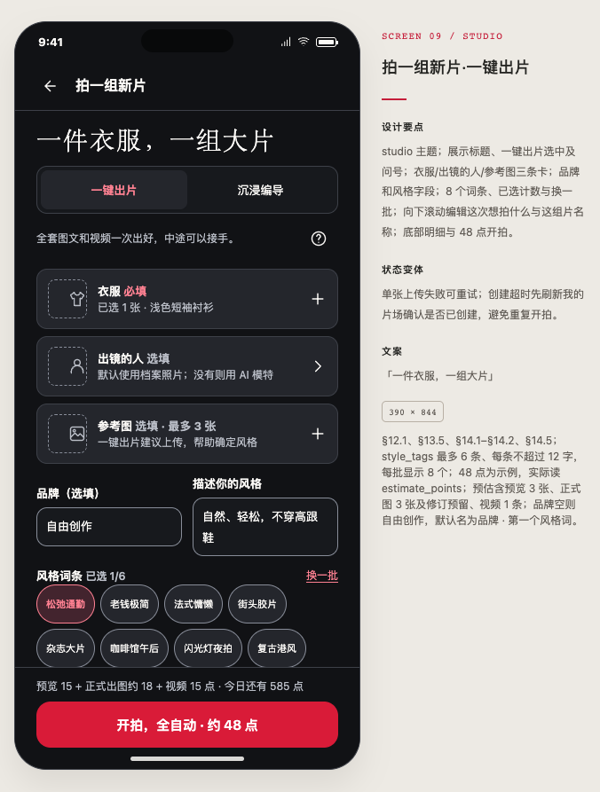

| 状态 | 设计处理 |
|---|---|
| 空 | 衣服必填；出镜的人默认档案，可不选；参考图最多 3 张且建议上传；未上传本人照时明确使用 AI 模特。 |
| 加载 | 上传逐张显示第 n/N 张；报价读取中禁止以固定示例点数替代实际报价开拍。 |
| 错误 | 单张上传失败可重试；创建超时先刷新我的片场确认是否已创建，避免重复开拍。 |
| 成功 | 提交 mode=auto 与风格词条，进入自动进行中的编导间。 |
| 点数不足 | 预估超过剩余点数时按钮置灰，显示今日点数不够了，明天 00:00 恢复。 |

**文案口径：** 「一件衣服，一组大片」；「一键出片」；「全套图文和视频一次出好，中途可以接手。」；「衣服」；「必填」；「出镜的人」；「选填」；「参考图」；「选填 · 最多 3 张」；「品牌（选填）」；「描述你的风格」；「风格词条」；「已选 1/6」；「换一批」；「预览 15 + 正式出图约 18 + 视频 15 点 · 今日还有 585 点」；「开拍，全自动 · 约 48 点」；「这次想拍什么」；「周末去咖啡馆，拍一组日常穿搭。」；「这组片名称（可改）」；「自由创作 · 松弛通勤」。

**契约映射：** §12.1、§13.5、§14.1–§14.2、§14.5；style_tags 最多 6 条、每条不超过 12 字，每批显示 8 个；48 点为示例，实际读 estimate_points；预估含预览 3 张、正式图 3 张及修订预留、视频 1 条；品牌空则自由创作，默认名为品牌 · 第一个风格词。

[查看该页向下滚动后的内容](design/shots/new-auto-continued.png)。

### 4.10 拍一组新片·沉浸编导

**目标：** 整理衣服、人物和偏好，开启逐步讨论的创作。

**布局：** studio 主题；沉浸编导选中及模式说明/问号；衣服未上传状态与另外两条素材卡；品牌、风格字段和 8 个词条；向下滚动编辑这次想拍什么与这组片名称；底部开拍按钮置灰。

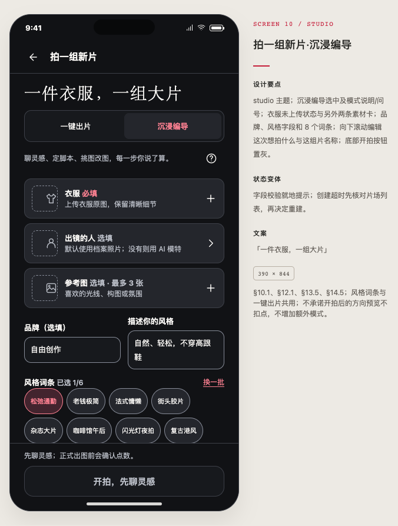

| 状态 | 设计处理 |
|---|---|
| 空 | 衣服必填；品牌、出镜的人、参考图选填；无本人照片时使用 AI 模特。 |
| 加载 | 上传显示第 n/N 张；创建中保留表单并阻止重复提交。 |
| 错误 | 字段校验就地提示；创建超时先核对片场列表，再决定重建。 |
| 成功 | 提交 mode=guided，进入编导间看懂衣服并讨论方向。 |
| 点数不足 | 不得绕过方向预览点数校验；不足时说明明天 00:00 恢复，已有资料保留。 |

**文案口径：** 「一件衣服，一组大片」；「沉浸编导」；「聊灵感、定脚本、挑图改图，每一步你说了算。」；「上传衣服原图，保留清晰细节」；「默认使用档案照片；没有则用 AI 模特」；「参考图」；「选填 · 最多 3 张」；「描述你的风格」；「开拍，先聊灵感」；「这次想拍什么」；「这组片名称（可改）」；「自由创作 · 松弛通勤」。

**契约映射：** §10.1、§12.1、§13.5、§14.5；风格词条与一键出片共用；不承诺开拍后的方向预览不扣点，不增加额外模式。

### 4.11 编导间·方向

**目标：** 用 2–3 个有依据的场景方向帮助用户做一次选择。

**布局：** paper 主题；用户偏好消息与助手引语；两张方向卡含预览、场景光线和推荐理由；换一组旁列 15 点；过程行；底部方向确认及自由文本输入。

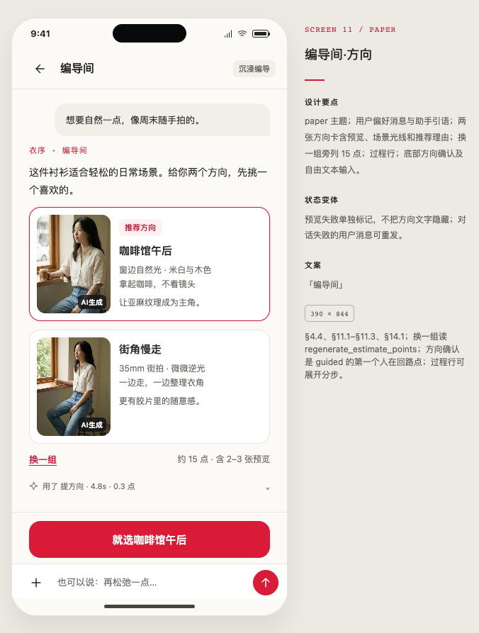

| 状态 | 设计处理 |
|---|---|
| 空 | 尚未产出方向时保留衣服与这次想拍什么，允许补充偏好。 |
| 加载 | 方向文字流式呈现；预览图按排队中/生成中显示固定比例占位。 |
| 错误 | 预览失败单独标记，不把方向文字隐藏；对话失败的用户消息可重发。 |
| 成功 | 选定方向进入脚本；继续聊天可调整偏好；换一组保留已说过的偏好。 |
| 点数不足 | 换一组不足时置灰并提示明日恢复，现有方向仍可查看和选择。 |

**文案口径：** 「编导间」；「沉浸编导」；「想要自然一点，像周末随手拍的。」；「推荐方向」；「咖啡馆午后」；「街角慢走」；「换一组」；「约 15 点 · 含 2–3 张预览」；「用了 提方向 · 4.8s · 0.3 点」；「就选咖啡馆午后」；「也可以说：再松弛一点…」。

**契约映射：** §4.4、§11.1–§11.3、§14.1；换一组读 regenerate_estimate_points；方向确认是 guided 的第一个人在回路点；过程行可展开分步。

### 4.12 编导间·脚本

**目标：** 先核对封面、镜头和文案计划，再明确确认正式出图。

**布局：** paper 主题；助手说明；脚本草稿 v2 卡列标题、封面与三个镜头及视频动作；历史与恢复提示；过程行；底部 18 点、单独确认视频说明及修改脚本的对话输入。

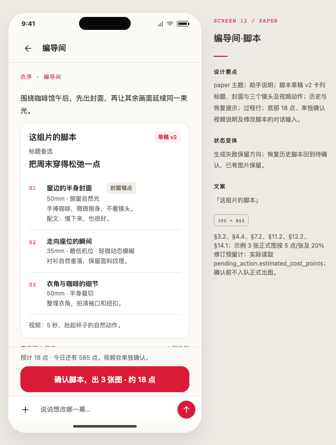

| 状态 | 设计处理 |
|---|---|
| 空 | 方向未定时不显示可确认脚本，引导先选择方向。 |
| 加载 | 脚本生成中显示文字进度，确认按钮不可用。 |
| 错误 | 生成失败保留方向；恢复历史脚本回到待确认，已有图片保留。 |
| 成功 | 确认后先出封面，再以封面作为其余镜头的视觉锚点；可在确认前自由修改。 |
| 点数不足 | 预估超过剩余点数时确认按钮置灰，提示今日点数不够了，明天 00:00 恢复。 |

**文案口径：** 「这组片的脚本」；「草稿 v2」；「标题备选」；「把周末穿得松弛一点」；「窗边的半身封面」；「封面锚点」；「查看脚本历史」；「v1 可恢复」；「用了 写脚本 · 4.8s · 0.3 点」；「预计 18 点 · 今日还有 585 点。视频会单独确认。」；「确认脚本，出 3 张图 · 约 18 点」；「说说想改哪一幕…」。

**契约映射：** §3.2、§4.4、§7.2、§11.2、§12.2、§14.1；示例 3 张正式图按 5 点/张及 20% 修订预留计；实际读取 pending_action.estimated_cost_points；确认前不入队正式出图。

### 4.13 编导间·自动进行中

**目标：** 展示自动创作当前步骤，并随时允许用户接手。

**布局：** paper 主题；自动通知提示；方向/脚本/图片/笔记/视频五段步骤；出图 2/3 卡和缩略图；主动播报；接手说明与按钮；预估和剩余；底部对话输入。

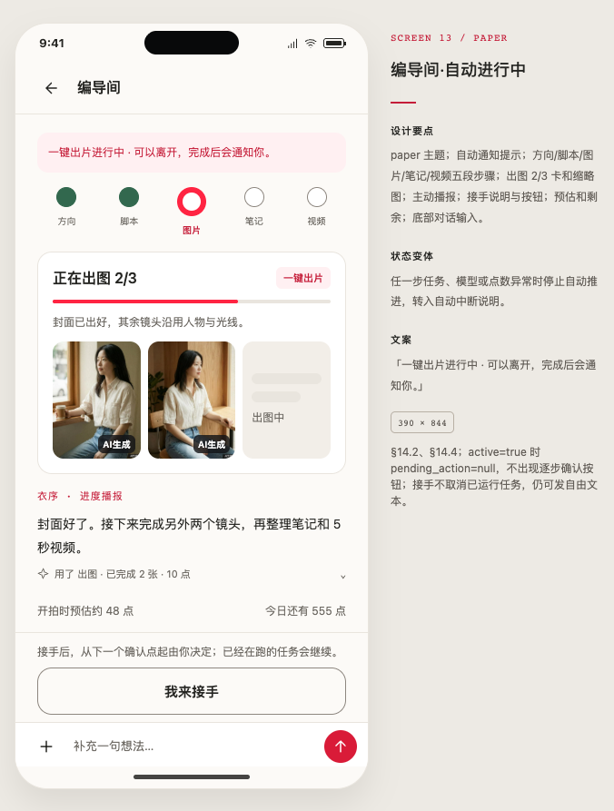

| 状态 | 设计处理 |
|---|---|
| 空 | 尚未开始自动任务时不伪造进度，返回开拍前的确认。 |
| 加载 | 按 state.auto.step 显示当前步骤；板上呈现五段活动步骤，出图显示 2/3，不承诺虚构的剩余秒数。 |
| 错误 | 任一步任务、模型或点数异常时停止自动推进，转入自动中断说明。 |
| 成功 | 视频完成后显示全套已出好；接手后已在跑的任务继续，到下一个确认点等待。 |
| 点数不足 | 自动流程遇到不足即停在当前阶段，转回沉浸编导并说明明日恢复。 |

**文案口径：** 「一键出片进行中 · 可以离开，完成后会通知你。」；「方向」；「脚本」；「图片」；「笔记」；「视频」；「正在出图 2/3」；「我来接手」；「接手后，从下一个确认点起由你决定；已经在跑的任务会继续。」；「开拍时预估约 48 点」；「今日还有 555 点」。

**契约映射：** §14.2、§14.4；active=true 时 pending_action=null，不出现逐步确认按钮；接手不取消已运行任务，仍可发自由文本。

### 4.14 编导间·自动中断

**目标：** 解释自动流程停在哪里，并把可恢复操作交回用户。

**布局：** paper 主题；五段步骤停在图片；已转为沉浸编导提示；两张成功图与一张失败占位；下一步操作区；断网恢复说明；底部对话输入。

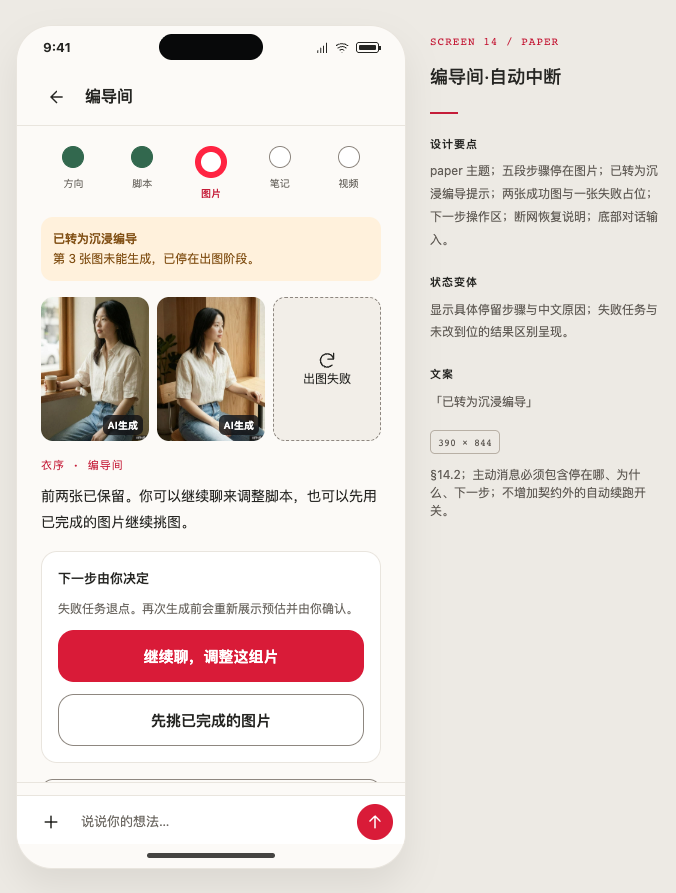

| 状态 | 设计处理 |
|---|---|
| 空 | 没有中断原因时不杜撰任务失败，读取最新片场状态。 |
| 加载 | 重读状态中保留已完成内容，不自动重开整套流程。 |
| 错误 | 显示具体停留步骤与中文原因；失败任务与未改到位的结果区别呈现。 |
| 成功 | mode 已转 guided，用户在当前阶段处理问题后按沉浸编导继续。 |
| 点数不足 | 显示今日点数不够了，明天 00:00 恢复；浏览和编辑已有内容继续可用。 |

**文案口径：** 「已转为沉浸编导」；「第 3 张图未能生成，已停在出图阶段。」；「前两张已保留。你可以继续聊来调整脚本，也可以先用已完成的图片继续挑图。」；「下一步由你决定」；「失败任务退点。再次生成前会重新展示预估并由你确认。」；「继续聊，调整这组片」；「先挑已完成的图片」；「网络中断时保留已知进度。」；「连接恢复后重新读取这组片，不重复开拍。」。

**契约映射：** §14.2；主动消息必须包含停在哪、为什么、下一步；不增加契约外的自动续跑开关。

### 4.15 图片查看器

**目标：** 看清服装细节、比较修订，并明确当前采用版本。

**布局：** 深色全屏；原图完整显示并保留原生 AI 标识，叠未改到位角标；镜头 v2、人像 92 与检查原因；v1/v2 版本条；前后对比、引用、保存及长按菜单说明；底部局部改、再试一次和仍然采用。

| 状态 | 设计处理 |
|---|---|
| 空 | 没有成功图片时显示当前镜头尚无可查看图片，保留返回入口。 |
| 加载 | 图片与新版本分别显示加载状态；旧版可继续查看。 |
| 错误 | 图片失败可重载；image.edit_check.passed === false 显示未改到位与原因，不标记任务失败。 |
| 成功 | 新版本加入版本条；默认采用最新成功且核对通过或无 edit_check 的版本；note 阶段可采用此版本到笔记。 |
| 点数不足 | 看图、对比和引用不扣点；提交改图不足时阻止新任务并提示明日恢复。 |

**文案口径：** 「未改到位」；「镜头 01 · v2」；「人像 92」；「袖口仍有卷起，未完全放平。笔记仍采用 v1。」；「v1 · 已采用」；「v2 · 未通过」；「前后对比」；「引用」；「保存」；「局部改」；「再试一次 · 约 5 点」；「仍然采用」；「长按：局部改 / 整张改 / 引用到对话 / 对比版本 / 保存到相册」；「双指缩放 · 双击放大 · 左右切换图片」。

**契约映射：** §8.1、§12.2、§13.1、§13.3；按 parent_id 展示 v1/v2/v3；左右滑、双指缩放、双击放大；长按提供五项菜单；video/done 阶段不开放重新采用。

### 4.16 涂抹局部改

**目标：** 明确要改的位置和最终效果，保留选区之外的画面。

**布局：** 深色查看器；完整原图保留原生 AI 标识，叠袖口涂抹选区；涂抹、框选、撤销、清空四项；笔刷滑杆；三个快捷词条和目标描述；底部剩余点数与 5 点提交。

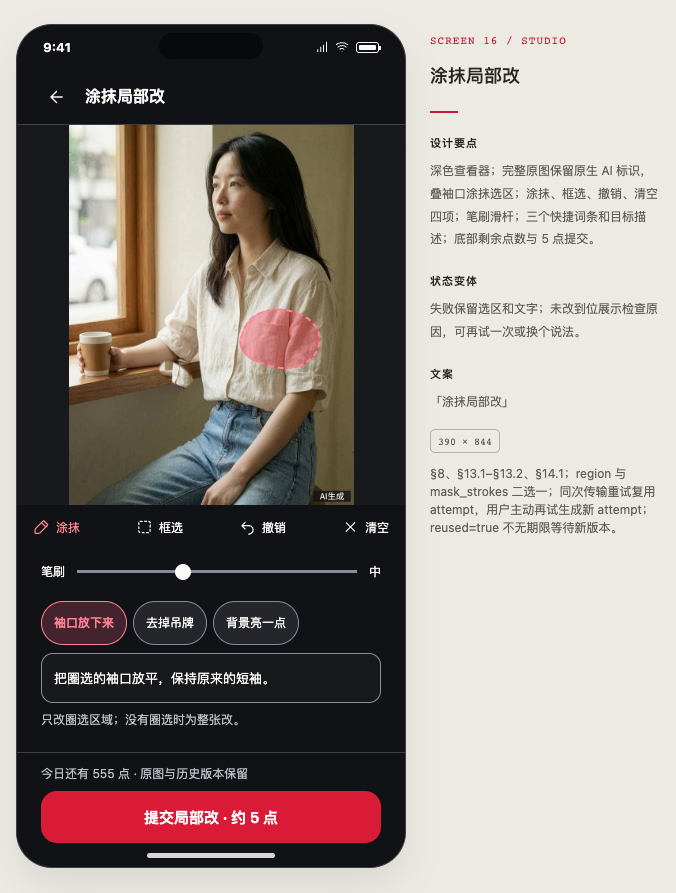

| 状态 | 设计处理 |
|---|---|
| 空 | 未写修改要求时提示补全；未画选区时按整张改处理，并明确说明范围。 |
| 加载 | 提交后显示排队或改图中，保留父图与指令，不重复提交。 |
| 错误 | 失败保留选区和文字；未改到位展示检查原因，可再试一次或换个说法。 |
| 成功 | 新版本加入版本条并显示检查结果；选区外画面保持不变。 |
| 点数不足 | 剩余点数不足时提交置灰，选区与指令保留，提示明日恢复。 |

**文案口径：** 「涂抹局部改」；「涂抹」；「框选」；「撤销」；「清空」；「笔刷」；「袖口放下来」；「去掉吊牌」；「背景亮一点」；「把圈选的袖口放平，保持原来的短袖。」；「只改圈选区域；没有圈选时为整张改。」；「提交局部改 · 约 5 点」。

**契约映射：** §8、§13.1–§13.2、§14.1；region 与 mask_strokes 二选一；同次传输重试复用 attempt，用户主动再试生成新 attempt；reused=true 不无期限等待新版本。

### 4.17 挑图

**目标：** 按镜头选出笔记用图和顺序，并区分核对结果。

**布局：** paper 主题；三张缩略图按序号排列，第二张标记手动采用；选图说明卡及原因确认提示；底部已选数量与采用整理笔记。

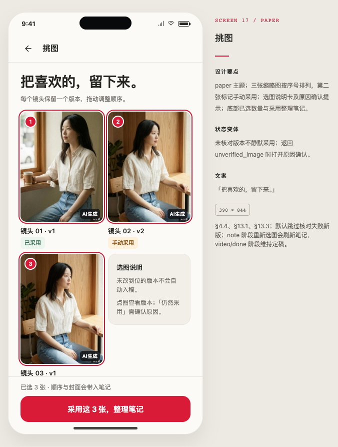

| 状态 | 设计处理 |
|---|---|
| 空 | 尚无已选图片时提示至少选择一张成功图片，不写入空笔记。 |
| 加载 | 待生成镜头保留占位；提交选图时锁定重复提交。 |
| 错误 | 未核对版本不静默采用；返回 unverified_image 时打开原因确认。 |
| 成功 | 按用户顺序提交 image_ids；手动采用图另带 accept_unverified，结果同步笔记与发布清单。 |
| 点数不足 | 选择、排序和查看不扣点；后续有扣点操作时独立校验，不阻止整理已有图片。 |

**文案口径：** 「把喜欢的，留下来。」；「每个镜头保留一个版本，拖动调整顺序。」；「已采用」；「手动采用」；「未改到位的版本不会自动入稿。」；「已选 3 张 · 顺序与封面会带入笔记」；「采用这 3 张，整理笔记」。

**契约映射：** §4.4、§13.1、§13.3；默认跳过核对失败新版；note 阶段重新选图会刷新笔记，video/done 阶段维持定稿。

### 4.18 仍然采用确认

**目标：** 在用户主动采用未核对通过的版本前，说明具体风险。

**布局：** paper 挑图背景上叠遮罩与底部 Sheet；显示未改到位、检查原因及入稿后标记；确认采用与返回保留原版两个按钮。

| 状态 | 设计处理 |
|---|---|
| 空 | 没有核对失败版本时不显示此确认。 |
| 加载 | 确认提交中防止重复采用，保留检查原因。 |
| 错误 | 采用请求失败保留确认上下文；不把该图标为已入稿。 |
| 成功 | 明确确认后发送 accept_unverified，并在笔记和发布清单标记手动采用。 |
| 点数不足 | 此确认本身不扣点，不要求点数。 |

**文案口径：** 「仍然采用这个版本？」；「检查结果：袖口仍有卷起，未完全放平。」；「采用后，这张图会进入笔记和视频候选；预览与发布清单会标记「手动采用」。」；「确认，仍然采用」；「返回，保留原版」。

**契约映射：** §13.1；显示 edit_check.reason；只在用户主动确认后加入 accept_unverified，不自动将失败改为通过。

### 4.19 笔记预览

**目标：** 把已采用的图片整理成可编辑、可保存和可发布的图文。

**布局：** paper 主题；页头保存草稿；封面大图和三张顺序缩略图，第二张手动采用；标题与 10/20 计数；正文、可增删话题、已勾 AI 声明；重新选图/恢复入口及准备发布。

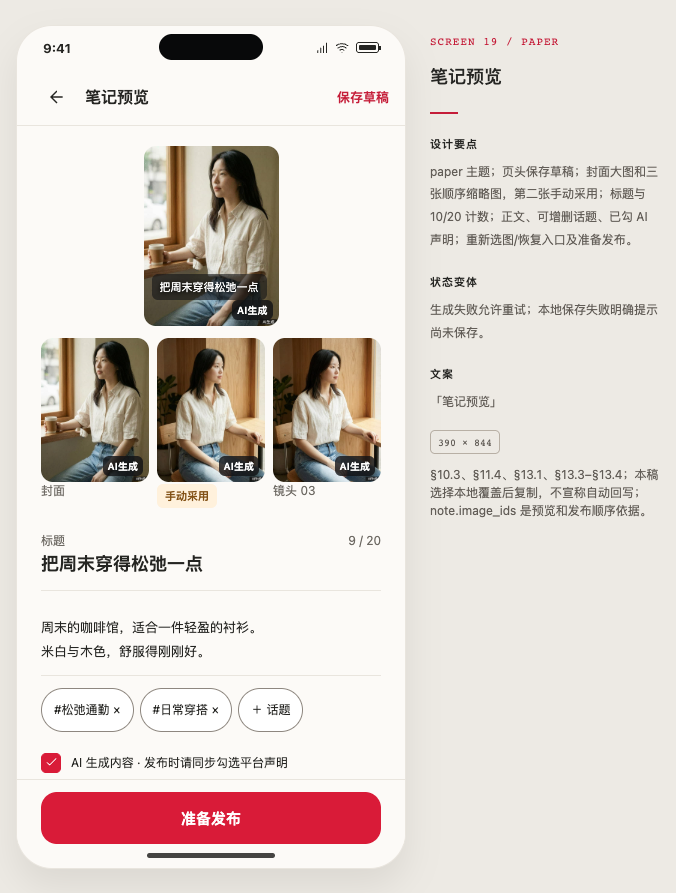

| 状态 | 设计处理 |
|---|---|
| 空 | 未采用图片时引导先挑图，不显示不存在的笔记正文。 |
| 加载 | 笔记生成中保留已选图片；更新时不清空本地编辑。 |
| 错误 | 生成失败允许重试；本地保存失败明确提示尚未保存。 |
| 成功 | 标题、正文、标签作为本地覆盖稿保存并用于复制；未编辑草稿跟随最新笔记，已编辑草稿遇更新先提示。 |
| 点数不足 | 查看和编辑已有笔记不扣点；新增视频等操作另行预估和校验。 |

**文案口径：** 「笔记预览」；「保存草稿」；「手动采用」；「标题」；「10 / 20」；「把周末穿得松弛一点」；「#松弛通勤 ×」；「#日常穿搭 ×」；「＋ 话题」；「AI 生成内容 · 发布时请同步勾选平台声明」；「重新选图」；「恢复服务端版本」；「准备发布」。

**契约映射：** §10.3、§11.4、§13.1、§13.3–§13.4；本稿选择本地覆盖后复制，不宣称自动回写；note.image_ids 是预览和发布顺序依据。

[查看该页向下滚动后的内容](design/shots/note-continued.png)。

### 4.20 笔记新版本

**目标：** 当远端笔记更新时保护用户已编辑的本地草稿。

**布局：** paper 主题；新版本提示带内两项选择；保留当前本地文案卡和三张图；已保存反馈；解释两项选择结果；恢复服务端版本与准备发布。

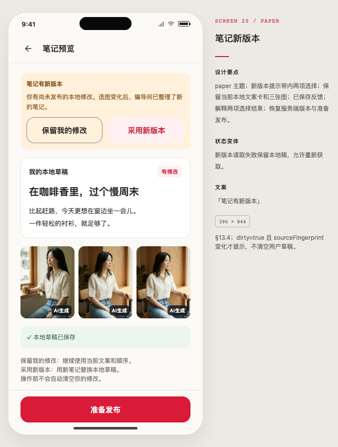

| 状态 | 设计处理 |
|---|---|
| 空 | 本地未编辑时不显示冲突，直接采用最新笔记。 |
| 加载 | 读取最新笔记中保留当前草稿，不提前覆盖。 |
| 错误 | 新版本读取失败保留本地稿，允许重新获取。 |
| 成功 | 选择保留则继续编辑本地稿；选择采用则更新表单和图片顺序；始终提供恢复服务端版本入口。 |
| 点数不足 | 草稿冲突处理不扣点。 |

**文案口径：** 「笔记有新版本」；「你有尚未发布的本地修改。选图变化后，编导间已整理了新的笔记。」；「保留我的修改」；「采用新版本」；「我的本地草稿」；「本地草稿已保存」；「恢复服务端版本」；「准备发布」。

**契约映射：** §13.4；dirty=true 且 sourceFingerprint 变化才提示，不清空用户草稿。

### 4.21 发布清单

**目标：** 将图片、文案、视频和 AI 声明一起核对，完成系统分享交接。

**布局：** paper 主题；三张图与发布清单；图片、视频、待复制文案、AI 声明四行；手动采用原因；分享步骤说明、相册权限说明；准备发布按钮。

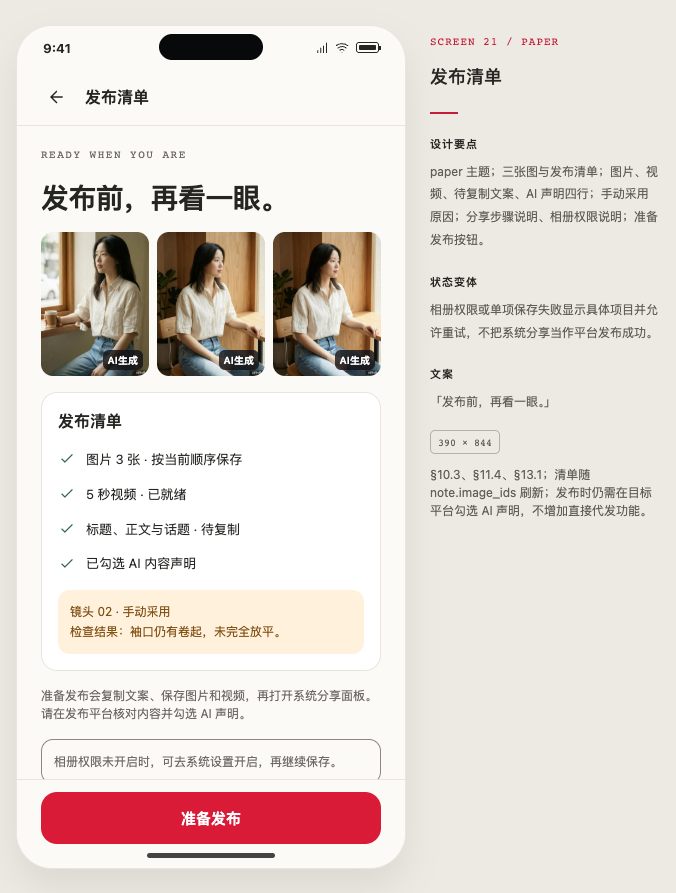

| 状态 | 设计处理 |
|---|---|
| 空 | 没有已采用图片时返回挑图；未生成视频时明确本次仅图文，不虚构视频文件。 |
| 加载 | 按复制文案、保存图片、保存视频顺序展示进度，不提前显示全部完成。 |
| 错误 | 相册权限或单项保存失败显示具体项目并允许重试，不把系统分享当作平台发布成功。 |
| 成功 | 复制文案、按顺序保存全部图片及已有视频后打开系统分享面板。 成功反馈为「文案已复制 · 图片 3/3 已保存」，视频按实际保存状态显示。 |
| 点数不足 | 复制、保存与分享已有内容不扣点。 |

**文案口径：** 「发布前，再看一眼。」；「发布清单」；「图片 3 张 · 按当前顺序保存」；「5 秒视频 · 已就绪」；「标题、正文与话题 · 待复制」；「已勾选 AI 内容声明」；「镜头 02 · 手动采用」；「准备发布」。

**契约映射：** §10.3、§11.4、§13.1；清单随 note.image_ids 刷新；发布时仍需在目标平台勾选 AI 声明，不增加直接代发功能。

### 4.22 视频就绪

**目标：** 查看已完成的 5 秒视频并纳入发布素材。

**布局：** paper 主题；完成标题与视频就绪徽标；带 AI 标识的封面、播放按钮和 5 秒进度；720P/音轨摘要、保存视频、已采用源图及定稿说明；发布清单按钮。

| 状态 | 设计处理 |
|---|---|
| 空 | 尚未生成时显示从当前笔记用图中选源图，guided 单独确认后才开始。 |
| 加载 | 排队或运行中显示视频生成中，允许离开并等待通知。 |
| 错误 | 生成失败显示原因；不把失败任务当作可播放视频。 |
| 成功 | 视频完成可播放、保存，并随发布清单导出。 |
| 点数不足 | 新建视频前显示预计 15 点和剩余点数；不足阻止提交，已有视频查看不扣点。 |

**文案口径：** 「这组片，拍好了。」；「视频就绪」；「5 秒 · 720P · 带音轨」；「保存视频」；「源图：镜头 01 · v1 · 已采用」；「视频阶段已定稿，图片顺序与版本不再变更。」；「查看发布清单」。

**契约映射：** §1.1、§3.2、§13.1、§14.1–§14.2；源图必须属于当前 note.image_ids；auto 已在开拍时授权，生成期间无额外确认。

### 4.23 点数不足

**目标：** 说明今日额度边界，同时保留用户已有进度。

**布局：** paper 编导间；保留三镜头脚本待确认卡；点数不足告知、18 点预估与剩余 8 点；正式出图按钮置灰；视频另行确认说明；返回片场与对话输入。

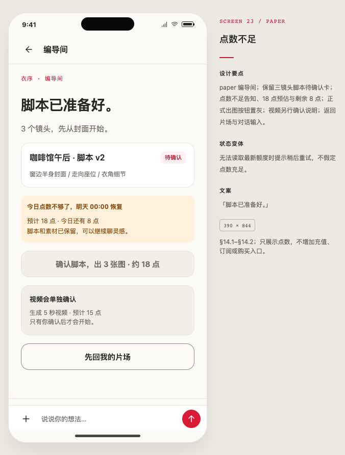

| 状态 | 设计处理 |
|---|---|
| 空 | 没有待扣点动作时不主动弹出阻断页。 |
| 加载 | 重新读取预算时保留当前内容，暂不提交新任务。 |
| 错误 | 无法读取最新额度时提示稍后重试，不假定点数充足。 |
| 成功 | 额度恢复且核对通过后，用户重新确认原操作；不自动补交任务。 |
| 点数不足 | 预估超过剩余点数时不入队；auto 转回沉浸编导并停在当前阶段。 |

**文案口径：** 「脚本已准备好。」；「今日点数不够了，明天 00:00 恢复」；「预计 18 点 · 今日还有 8 点」；「脚本和素材已保留，可以继续聊灵感。」；「视频会单独确认」；「生成 5 秒视频 · 预计 15 点」；「先回我的片场」。

**契约映射：** §14.1–§14.2；只展示点数，不增加充值、订阅或购买入口。

### 4.24 我的片场

**目标：** 按标题或品牌查找、继续和管理自己的创作。

**布局：** studio 主题；标题与排序/刷新提示；搜索框；三张片场卡含封面和阶段；删除二次确认卡；底部拍一组新片。

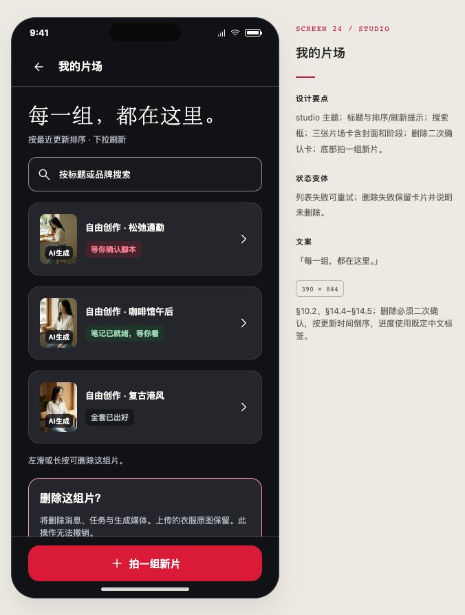

| 状态 | 设计处理 |
|---|---|
| 空 | 无片场时引导拍一组新片；搜索无结果时允许清空关键词。 |
| 加载 | 刷新保留现有卡片，首次加载使用骨架。 |
| 错误 | 列表失败可重试；删除失败保留卡片并说明未删除。 |
| 成功 | 点卡片进入对应编导间；确认删除后移除这组片及关联生成内容，上传衣服原图保留。 |
| 点数不足 | 搜索、查看和删除不扣点，仍可管理已有片场。 |

**文案口径：** 「每一组，都在这里。」；「按最近更新排序 · 下拉刷新」；「按标题或品牌搜索」；「等你确认脚本」；「笔记已就绪，等你看」；「全套已出好」；「删除这组片？」；「上传的衣服原图保留。」；「取消」；「删除这组片」；「拍一组新片」。

**契约映射：** §10.2、§14.4–§14.5；删除必须二次确认，按更新时间倒序，进度使用既定中文标签。

### 4.25 我的形象

**目标：** 保存本人照片与穿衣偏好，为之后的片场提供默认选择。

**布局：** paper 主题；昵称；出镜的人卡使用图标占位而非成片，显示未上传和上传入口；身高、体型、风格字段；默认说明与已保存反馈；底部保存。

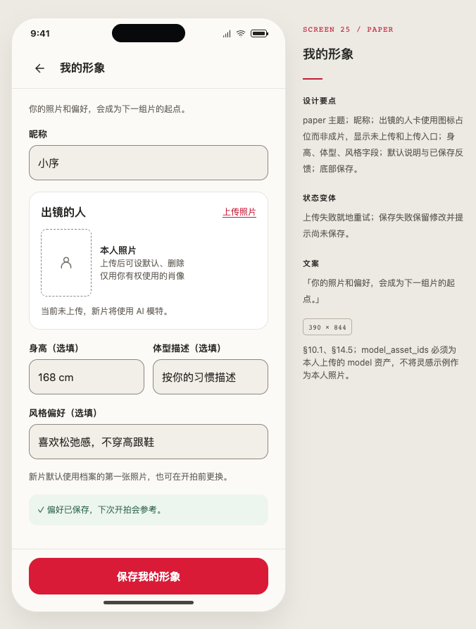

| 状态 | 设计处理 |
|---|---|
| 空 | 无本人照片时说明新片场可使用 AI 模特，不用灵感成片填充本人档案。 |
| 加载 | 照片逐张显示上传进度；保存中保留表单。 |
| 错误 | 上传失败就地重试；保存失败保留修改并提示尚未保存。 |
| 成功 | 保存后第一张或设定默认照片用于新片场，偏好进入方向和脚本上下文。 |
| 点数不足 | 管理档案与上传本人照片不扣点。 |

**文案口径：** 「你的照片和偏好，会成为下一组片的起点。」；「昵称」；「出镜的人」；「上传照片」；「本人照片」；「当前未上传，新片将使用 AI 模特。」；「身高（选填）」；「体型描述（选填）」；「风格偏好（选填）」；「保存我的形象」。

**契约映射：** §10.1、§14.5；model_asset_ids 必须为本人上传的 model 资产，不将灵感示例作为本人照片。

### 4.26 设置

**目标：** 集中呈现形象、点数、账号和帮助信息。

**布局：** paper 主题；昵称和账号摘要；585/600 点卡与恢复时间；我的形象、账号与安全、协议与隐私、关于四个入口；退出登录和保存草稿提示。

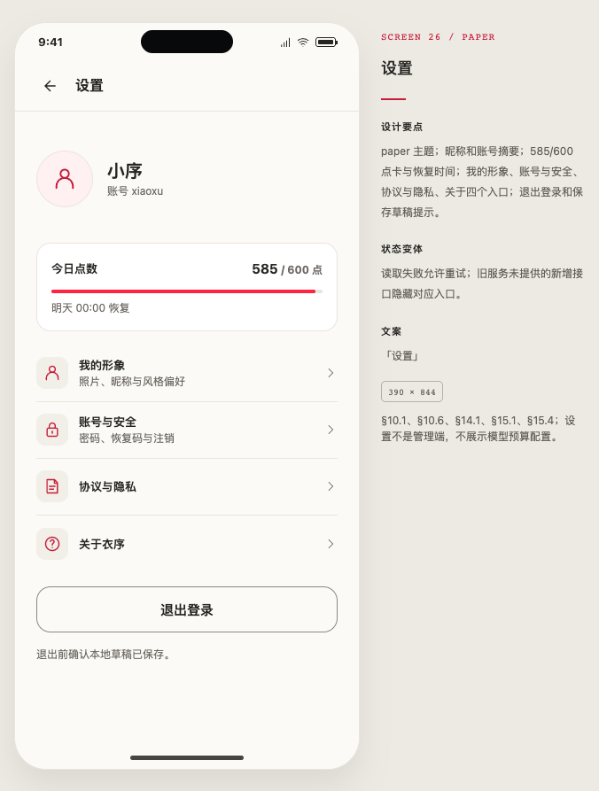

| 状态 | 设计处理 |
|---|---|
| 空 | 档案未完善时显示补充本人照片和偏好入口，不填充虚构资料。 |
| 加载 | 用户信息和点数读取中显示占位，不显示虚构余额。 |
| 错误 | 读取失败允许重试；旧服务未提供的新增接口隐藏对应入口。 |
| 成功 | 显示当前账号与点数，各入口进入对应页面。 |
| 点数不足 | 今日剩余为零时仍可使用设置，说明明天 00:00 恢复。 |

**文案口径：** 「设置」；「今日点数」；「585 / 600 点」；「明天 00:00 恢复」；「我的形象」；「账号与安全」；「协议与隐私」；「关于衣序」；「退出登录」；「退出前确认本地草稿已保存。」。

**契约映射：** §10.1、§10.6、§14.1、§15.1、§15.4；设置不是管理端，不展示模型预算配置。

### 4.27 账号与安全

**目标：** 让用户能维护密码、恢复凭据并退出账号生命周期。

**布局：** paper 主题；当前账号卡；修改密码、恢复码、协议与隐私三项；恢复码唯一找回方式告知；底部独立注销入口。

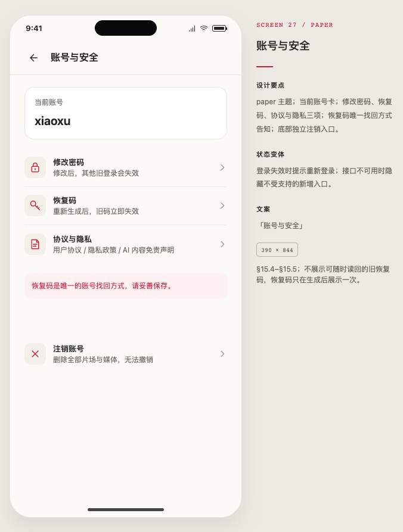

| 状态 | 设计处理 |
|---|---|
| 空 | 未登录时进入登录页，不暴露其他账号资料。 |
| 加载 | 账号读取中保留标题，不显示示例账号为真实资料。 |
| 错误 | 登录失效时提示重新登录；接口不可用时隐藏不受支持的新增入口。 |
| 成功 | 进入修改密码、重新生成恢复码或注销二次确认。 |
| 点数不足 | 账号安全操作不扣点，不受今日额度限制。 |

**文案口径：** 「账号与安全」；「当前账号」；「修改密码」；「修改后，其他旧登录会失效」；「恢复码」；「重新生成后，旧码立即失效」；「协议与隐私」；「恢复码是唯一的账号找回方式，请妥善保存。」；「注销账号」。

**契约映射：** §15.4–§15.5；不展示可随时读回的旧恢复码，恢复码只在生成后展示一次。

### 4.28 修改密码

**目标：** 验证当前密码后更新凭据，明确其他登录会失效。

**布局：** paper 主题；标题与旧登录失效说明；当前密码和新密码；安全提示；修改密码按钮及成功反馈。

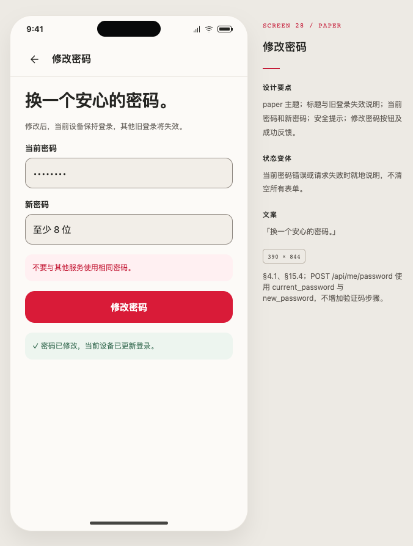

| 状态 | 设计处理 |
|---|---|
| 空 | 任一必填项为空时不提交，新密码提示至少 8 位。 |
| 加载 | 保存中防止重复提交，密码保持遮挡。 |
| 错误 | 当前密码错误或请求失败时就地说明，不清空所有表单。 |
| 成功 | 显示密码已修改；当前设备取得新登录凭据，此前签发的登录失效。 |
| 点数不足 | 修改密码不扣点。 |

**文案口径：** 「换一个安心的密码。」；「修改后，当前设备保持登录，其他旧登录将失效。」；「当前密码」；「新密码」；「至少 8 位」；「修改密码」；「密码已修改，当前设备已更新登录。」。

**契约映射：** §4.1、§15.4；POST /api/me/password 使用 current_password 与 new_password，不增加验证码步骤。

### 4.29 重新生成恢复码

**目标：** 验证密码后替换旧恢复码，并要求保存新码。

**布局：** paper 主题；钥匙图标与标题；生成原因说明；当前密码字段；旧码失效及只展示一次告知；验证生成按钮；接下来保存新码的说明卡。

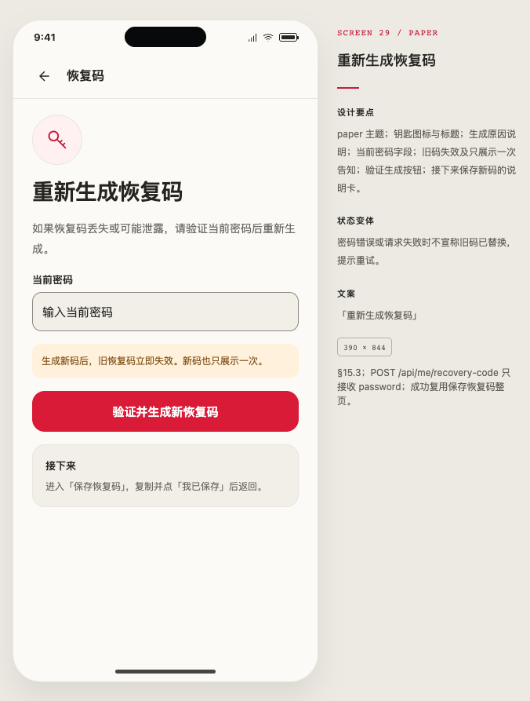

| 状态 | 设计处理 |
|---|---|
| 空 | 未输入密码时按钮置灰，不读取或展示旧码。 |
| 加载 | 验证并生成中阻止重复操作。 |
| 错误 | 密码错误或请求失败时不宣称旧码已替换，提示重试。 |
| 成功 | 新恢复码仅展示这一次；旧码失效；复制并点击我已保存后返回。 |
| 点数不足 | 重新生成恢复码不扣点。 |

**文案口径：** 「重新生成恢复码」；「如果恢复码丢失或可能泄露，请验证当前密码后重新生成。」；「当前密码」；「生成新码后，旧恢复码立即失效。新码也只展示一次。」；「验证并生成新恢复码」；「进入「保存恢复码」，复制并点「我已保存」后返回。」。

**契约映射：** §15.3；POST /api/me/recovery-code 只接收 password；成功复用保存恢复码整页。

### 4.30 忘记密码

**目标：** 用注册时保存的恢复码完成密码找回。

**布局：** paper 主题；用户名、错误态恢复码、新密码三字段；统一失败提示；验证重置按钮；旧登录/旧码失效与新码保存提醒；顶部返回。

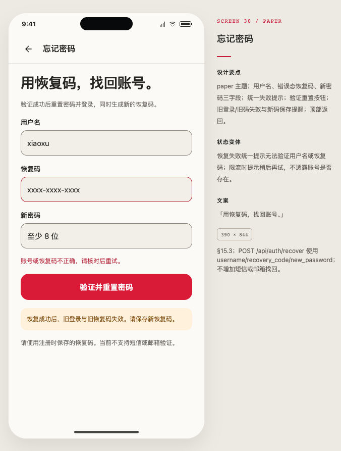

| 状态 | 设计处理 |
|---|---|
| 空 | 任一字段为空时提示补全；恢复码按 xxxx-xxxx-xxxx 展示输入提示。 |
| 加载 | 验证中防止重复提交，不提前登录。 |
| 错误 | 恢复失败统一提示无法验证用户名或恢复码；限流时提示稍后再试，不透露账号是否存在。 |
| 成功 | 重置密码、使旧登录失效并换发新恢复码；保存新码后进入首页。 |
| 点数不足 | 恢复账号不扣点。 |

**文案口径：** 「用恢复码，找回账号。」；「用户名」；「恢复码」；「xxxx-xxxx-xxxx」；「新密码」；「至少 8 位」；「账号或恢复码不正确，请核对后重试。」；「验证并重置密码」；「恢复成功后，旧登录与旧恢复码失效。请保存新恢复码。」。

**契约映射：** §15.3；POST /api/auth/recover 使用 username/recovery_code/new_password；不增加短信或邮箱找回。

### 4.31 注销确认

**目标：** 在删除账号及个人创作资料之前取得明确的二次确认。

**布局：** paper 主题；危险图标与二次确认标题；账号与清理范围说明；不可找回提醒；当前密码；继续使用按钮；底部独立确认注销及返回登录提示。

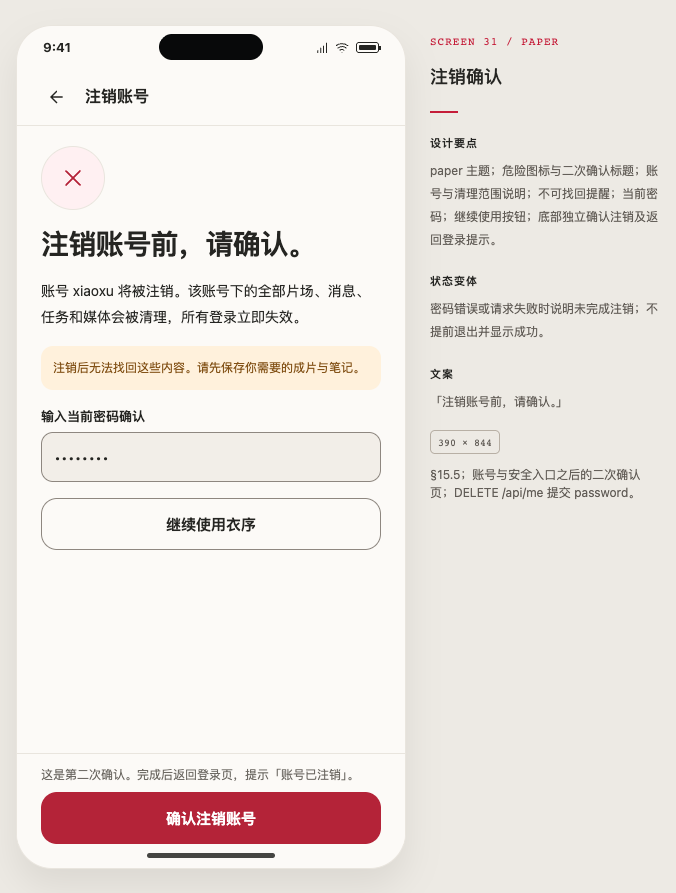

| 状态 | 设计处理 |
|---|---|
| 空 | 未输入密码时不能确认注销，取消返回账号与安全。 |
| 加载 | 注销处理中禁用重复提交，保留影响说明。 |
| 错误 | 密码错误或请求失败时说明未完成注销；不提前退出并显示成功。 |
| 成功 | 账号被注销且登录失效，回到登录页提示账号已注销。 |
| 点数不足 | 注销不扣点，不得以点数不足阻止删除账号。 |

**文案口径：** 「注销账号前，请确认。」；「注销后无法找回这些内容。请先保存你需要的成片与笔记。」；「输入当前密码确认」；「继续使用衣序」；「这是第二次确认。完成后返回登录页，提示「账号已注销」。」；「确认注销账号」。

**契约映射：** §15.5；账号与安全入口之后的二次确认页；DELETE /api/me 提交 password。

### 4.32 用户协议

**目标：** 用可读条款说明演示版服务、账号规则、点数和内容责任。

**布局：** paper 阅读页；三类协议标签；演示版主体和用户协议标题；四节设计摘录及联系邮箱；说明摘录不能代替正式全文。

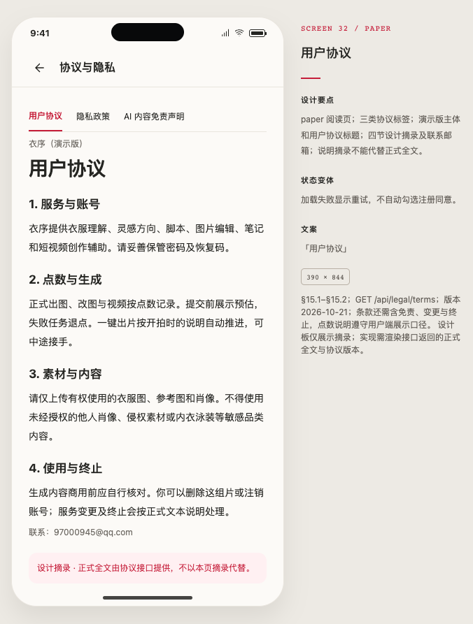

| 状态 | 设计处理 |
|---|---|
| 空 | 正文为空时不允许以空白页代替已阅读内容。 |
| 加载 | 正文加载中显示阅读骨架和返回入口。 |
| 错误 | 加载失败显示重试，不自动勾选注册同意。 |
| 成功 | 展示当前协议全文，返回原入口；阅读本身不等于已同意。 |
| 点数不足 | 协议公开可读，不扣点且无需登录。 |

**文案口径：** 「用户协议」；「衣序（演示版）」；「1. 服务与账号」；「2. 点数与生成」；「3. 素材与内容」；「4. 使用与终止」；「联系：97000945@qq.com」；「设计摘录 · 正式全文由协议接口提供，不以本页摘录代替。」。

**契约映射：** §15.1–§15.2；GET /api/legal/terms；版本 2026-10-21；条款还需含免责、变更与终止，点数说明遵守用户端展示口径。 设计板仅展示摘录；实现需渲染接口返回的正式全文与协议版本。

### 4.33 隐私政策

**目标：** 说明收集的资料、处理目的、保存与删除权利。

**布局：** paper 阅读页；隐私政策标签选中；资料、第三方、保存权利、未成年人四节摘录；联系方式；正式全文说明。

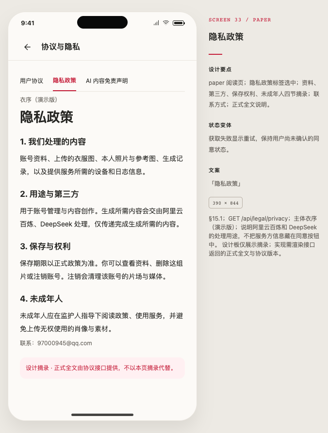

| 状态 | 设计处理 |
|---|---|
| 空 | 正文缺失时不显示为已读或已同意。 |
| 加载 | 加载中保留返回入口。 |
| 错误 | 获取失败显示重试，保持用户尚未确认的同意状态。 |
| 成功 | 完整展示政策，可返回隐私提示、注册、设置或关于入口。 |
| 点数不足 | 隐私政策公开可读，不扣点且无需登录。 |

**文案口径：** 「隐私政策」；「1. 我们处理的内容」；「2. 用途与第三方」；「3. 保存与权利」；「4. 未成年人」；「保存期限以正式政策为准。」；「联系：97000945@qq.com」；「设计摘录 · 正式全文由协议接口提供，不以本页摘录代替。」。

**契约映射：** §15.1；GET /api/legal/privacy；主体衣序（演示版）；说明阿里云百炼和 DeepSeek 的处理用途，不把服务方信息藏在同意按钮中。 设计板仅展示摘录；实现需渲染接口返回的正式全文与协议版本。

### 4.34 AI 内容免责声明

**目标：** 说明生成结果的局限、核对责任和发布标识要求。

**布局：** paper 阅读页；AI 内容免责声明标签选中；生成核对、AI 标识和改图检查三组摘录；联系方式及正式全文说明。

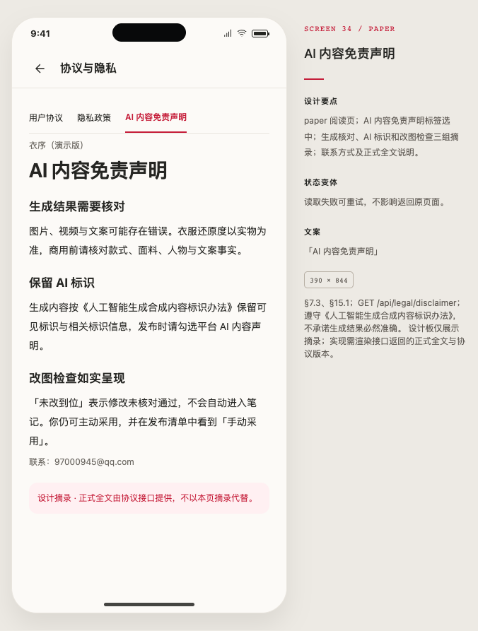

| 状态 | 设计处理 |
|---|---|
| 空 | 正文缺失时显示未取得内容，不以装饰性文字替代条款。 |
| 加载 | 加载中显示正文占位和返回。 |
| 错误 | 读取失败可重试，不影响返回原页面。 |
| 成功 | 展示完整说明，明确保留生成标识并在发布平台声明。 |
| 点数不足 | 免责声明公开可读，不扣点且无需登录。 |

**文案口径：** 「AI 内容免责声明」；「生成结果需要核对」；「保留 AI 标识」；「改图检查如实呈现」；「「未改到位」表示修改未核对通过，不会自动进入笔记。」；「联系：97000945@qq.com」；「设计摘录 · 正式全文由协议接口提供，不以本页摘录代替。」。

**契约映射：** §7.3、§15.1；GET /api/legal/disclaimer；遵守《人工智能生成合成内容标识办法》，不承诺生成结果必然准确。 设计板仅展示摘录；实现需渲染接口返回的正式全文与协议版本。

### 4.35 关于

**目标：** 让用户确认演示版身份、版本及相关说明入口。

**布局：** paper 主题；衣序品牌与演示说明；展示标题；1.0.0 演示版示意和运行时服务地址说明；三类协议入口与联系邮箱。

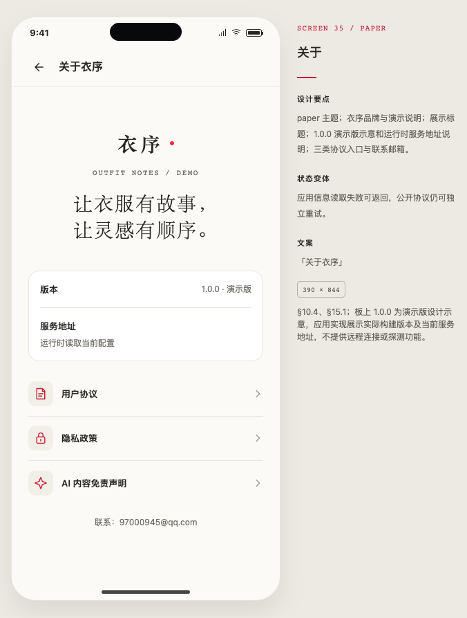

| 状态 | 设计处理 |
|---|---|
| 空 | 版本或服务地址未取得时显示暂不可用，不填入虚构远端地址。 |
| 加载 | 读取应用信息中保留协议入口。 |
| 错误 | 应用信息读取失败可返回，公开协议仍可独立重试。 |
| 成功 | 展示当前构建版本、实际服务地址与联系方式。 |
| 点数不足 | 查看关于不扣点。 |

**文案口径：** 「关于衣序」；「让衣服有故事，让灵感有顺序。」；「版本」；「1.0.0 · 演示版」；「服务地址」；「运行时读取当前配置」；「用户协议」；「隐私政策」；「AI 内容免责声明」；「联系：97000945@qq.com」。

**契约映射：** §10.4、§15.1；板上 1.0.0 为演示版设计示意，应用实现展示实际构建版本及当前服务地址，不提供远程连接或探测功能。

<!-- pages:end -->

## 5. 组件规格

以下为设计交付的目标接口；既有代码仍以实际导出为准，实现时保持旧调用兼容。所有组件从同一主题读取语义 token，`theme` 不作为每个按钮的独立属性。图标为 20px 线性图标；交互图标的容器至少 44 × 44。静态设计板里的图标和标签只表现布局，App 实现必须补齐交互语义。

| 组件 | 用途与主要 props | 变体 | 状态与行为 | 尺寸 / 对应画面 |
|---|---|---|---|---|
| **Button** | 主次动作；`title`、`onPress`、`variant`、`loading`、`disabled`、`icon?`、`accessibilityLabel?`（默认 title） | `primary / secondary / ghost / danger` | `default / pressed / disabled / loading`；按下 .975、160ms；loading 防重入并播报忙碌；禁用旁必须有原因；扣点动作 title 带预估，按钮外显示今日可用点数 | 默认高 52、紧凑高 44，水平 16、圆角 16；开拍、脚本确认、注销 |
| **IconButton** | 返回、关闭、引用等单图标动作；`name`、`label` 必填、`onPress`、`disabled?`、`selected?` | `ghost / subtle`；普通与选中 | `default / pressed / focused / disabled`；读屏读 label，不读图标名；扩触控区不能与相邻按钮重叠 | 触控 44 × 44、图标 20、圆角 12；Header、查看器工具栏 |
| **Field** | 账号、风格和文本输入；`label`、`value`、`onChangeText`、`placeholder?`、`hint?`、`error?`、`disabled?`、`secureTextEntry?`、`multiline?` | `singleline / multiline / password` | `default / focused / error / disabled`；标签常驻，placeholder 不替代标签；错误文本与边界同时出现；请求失败保留可安全重填的内容；密码不回显 | 输入最小高 48，内边 12，圆角 12；多行最小 80 并随内容增长；登录、新片、笔记 |
| **Chip** | 风格词条及话题；`label`、`selected?`、`disabled?`、`onPress?`、`onRemove?`、`accessibilityLabel` | `filter / removable / static` | `default / pressed / selected / disabled`；选中同时有文字与底色；风格最多 6 条、每条最多 12 字，每批显示 8 条；删除话题有独立可读标签 | 可操作最小高 44，水平 12、胶囊；8 条词条、多行换行 |
| **Segmented** | 两种创作模式、登录/注册；`options: {value,label}[]`、`value`、`onChange`、`label`、`disabled?` | `equal`（等宽，当前设计）；支持两主题 | `default / selected / pressed / disabled`；仅一个选中；屏幕阅读器读组名、选中项和项数；切模式保留素材与风格 | 外高 52，内项高 44、内距 4、圆角 12；新片、账号页 |
| **Card** | 方向、脚本、任务、档案；`children`、`title?`、`footer?`、`variant?`、`selected?`、`onPress?`、`accessibilityLabel?` | `surface / subtle / outlined / selected` | `default / selected / pressed`（可点时）；加载由 Skeleton 占位、错误由卡内 Notice 承载；整卡可选时公开选中状态，卡内子操作不触发整卡选择 | 内距 16、圆角 16、边线 1；卡间 12；方向图片 3:4 |
| **Badge** | 阶段、AI 标识、采用结果；`label`、`tone` | `brand / success / neutral / warning / danger` | 默认静态；状态文字必须明确，例如「未改到位」「手动采用」「已采用」；不单独作为可点按钮；生成成功与检查通过分开表达 | 字号 11 / 16、内距 4 × 8、圆角 6；若承载入口，由外层扩到 44 |
| **Sheet** | 模式问号说明、仍然采用确认、图片长按菜单；`visible`、`title`、`children`、`footer?`、`onDismiss`、`accessibilityLabel` | `info / actions / confirm` | `closed / opening / open / closing`；遮罩、系统返回和取消可关闭；弹出移入焦点，关闭返回触发点；确认前展示原因，确认过程中锁定重复提交；长内容可滚动 | 顶部圆角 20、水平 24、底部安全区；动效 360ms，减少动态效果时即时切换 |
| **StatePanel** | 空内容、加载失败、离线恢复；`state`、`icon`、`title`、`description`、`actionLabel?`、`onAction?` | `empty / error / offline` | 空态给下一步；错误给具体原因与重试；离线保留上次已知内容，不假装任务已停止；不把未改到位当任务失败 | 内距 24、圆角 20；主操作高 52；首次我的片场、列表错误、编导间离线 |
| **Toast** | 复制、保存、密码修改等短反馈；`text`、`tone`、`onDismiss?`、`durationMs?` | `success / danger / info` | `entering / visible / dismissed`；默认 6000ms，温和播报；关键失败与恢复入口留在页面内；不能只用自动消失 Toast 解释注销失败或点数不足 | 最小高 44、内距 12、圆角 12，文字可换行；恢复码已复制、草稿已保存 |
| **ProgressStrip** | 已知数量进度或当前步骤；`title`、`detail?`、`completed?`、`running?`、`total?`、`step?`、`indeterminate?` | `count / steps / indeterminate` | `queued / running / paused / succeeded / failed`；count 用完成量，不把 running 数当完成量；steps 显示方向/脚本/图片/笔记/视频；无可靠数量不报百分比；auto 的接手操作由页面固定区承载 | 轨道 4、卡内距 16；步骤点 20；进度来自状态，文字 13 / 20 |
| **ImageViewer** | 全屏看图、缩放、引用、版本比较与局部改；`images`、`initialImageId`、`versions`、`stage`、`editCheck?`、`onEdit`、`onReference`、`onSave`、`onAdopt?`、`onClose` | `view / compare / brush / region`；不圈选为整张改 | `loading / ready / failed / submitting / unverified`；未通过保留原版默认选择；「仍然采用」先弹原因确认；note 阶段可采用新版本，video/done 不提供重新采用；引用显示缩略图 | 390 × 844 全屏，原图 contain，控制区随内容滚动；笔刷轨迹与框坐标为 0–1，支持撤销、清空与粗细调节 |
| **VersionBar** | 同镜头的父子版本链；`versions`、`currentId`、`adoptedId?`、`onSelect`、`onCompare?`、`onAdopt?`、`stage` | `browse / compare / adopt` | `default / selected / adopted / unverified / locked`；只浏览不自动入稿；v2 未通过时默认仍为 v1；note 可「采用此版本到笔记」，替换同镜头并保序；video/done 只读 | 横向滚动、缩略图 3:4、可点区至少 44；文字显示版本及采用情况，首屏完整露出版本条 |
| **ThemeProvider** | 在应用根提供主题；`theme: paper / studio`、`children` | `paper / studio` | 按页面场景取主题；不把深浅主题作为用户新功能；设计板的全局预览仅是评审工具 | token 对应 §3，不单独产生界面 |
| **Page / Header** | 安全区、滚动和页面导航；`children`、`scroll?`；Header 的 `title`、`subtitle?`、`onBack?`、`right?` | `plain / scroll`；`back / root` | 正常、内容加载、标题更新；返回标签必填；有键盘时避免主动作遮挡字段；错误不卸载已填表单 | 最大内容宽 520；手机左右 24；Header 最小高 56，加系统安全区 |

### 5.1 组件组合与内容契约

主操作遵循同一组合：`Card / 内容 → 本次预估与今日可用点数 → Button`。预估读取 `pending_action.estimated_cost_points`；一键出片用 `quotes/auto.estimate_points` 与 `breakdown`；换一组用 `regenerate_estimate_points`；对话明细用 `trace.cost_points`，不到 0.1 点时显示「不到 0.1 点」。示例中的 48、18、15、5 点只说明构成，开发不得硬编码它们作为最新报价。

未改到位组合固定为 `ImageViewer + warning Badge + edit_check.reason + VersionBar`，恢复动作是「再试一次」「换个说法」「仍然采用」。新尝试生成新的 `attempt`，同一提交的网络重发复用 `attempt`；`reused=true` 时提示「这次和上次一样，没有重新生成」。质检不通过不改任务状态；用户确认采用后 `approve_images.accept_unverified` 记录图片，笔记与发布清单显示「手动采用」。

本稿选择 §11.4 允许的**本地覆盖后复制**：笔记标题、正文、标签和图片顺序的本地草稿用于发布，不增加保存笔记接口。草稿包含 `sourceFingerprint` 与 `dirty`；有冲突时先保留本地内容，再由用户选择。`note.image_ids` 的服务端修订仍通过 `approve_images`，本地编辑不假装已经写回服务端。

## 6. 可访问性清单

| 检查点 | 交付要求 | 本稿证据 / 实现验收 |
|---|---|---|
| 触控 | 所有可操作控件至少 44 × 44，主按钮高 52；词条、协议链接、版本缩略图均要有足够命中区域 | 浏览器验证设计板全部真实 button 高度至少 44；静态文字入口的命中区由 App 实现补齐，不能照搬 span |
| 对比度 | 普通文本至少 4.5:1，大字与关键图形至少 3:1；禁用原因仍须可读 | 实测 paper 主文 14.75:1、辅助文 5.23:1；studio 主文 17.98:1、辅助文 10.17:1。边线若承载输入边界，使用 input token，不能只用淡分隔线 |
| 状态语义 | 不仅靠红绿区分；生成成功、检查结果、采用结果分别播报 | 「未改到位」「手动采用」「已采用」文字常驻；警告有原因，进度有阶段与数量 |
| 动态字体 | 尊重系统字体缩放；1.0 / 1.3 倍、320 / 390 宽评审；文字增长时卡片和按钮换行，长页滚动 | 设计板检查了外层 390 / 720 / 1440 宽无横向溢出；App 的 320 宽及动态字体需在实现阶段验收，不能把固定画布截图当作验证 |
| 读屏标签 | 图标动作必填 label；输入有持久标签；词条、模式、采用版本读选中状态；图片有场景替代文字 | 登录 / 注册不是仅颜色的 tab；恢复码按字符可读取但不自动高声播报；图片的 AI 标识与核对结果可访问 |
| 焦点与键盘 | 逻辑顺序从标题到内容到主操作；Sheet 焦点封闭、可取消、关闭后返回原触发点；Web 控件有可见 focus ring | 主题预览可用键盘；正式表单、查看器与 Sheet 的焦点流程待实际组件验收 |
| 动效 | 尊重减少动态效果；长任务不要求盯着动画；进度变化温和播报 | 设计板支持 `prefers-reduced-motion`；截图关闭动画；生成流程允许离开与恢复 |
| 错误与权限 | 字段旁解释错误，不能只用 Toast；相册拒绝可去设置再继续；通知未授权不阻塞；网络恢复不重复扣点 | 发布清单说明保存失败项；普通写入超时不自动重放，先刷新确认状态；已完成镜头、版本与草稿保留 |
| 图片交互替代 | 缩放、切图、比较、局部改需有明确按钮；缩放手势不能是唯一入口 | 查看器菜单提供局部改 / 整张改 / 引用到对话 / 对比版本 / 保存到相册；选区支持框选替代涂抹 |

## 7. 设计到开发的交付清单

| 交付项 | 已交付内容 | 开发接入时的验收 |
|---|---|---|
| 页面与导航 | 35 个画布、每页目标 / 布局 / 五类状态 / 文案、4 条流程图 | 页面出口与契约一致；不把设置或账号页遗漏为死路；旧接口 404 时隐藏新增入口 |
| 视觉与 token | 两主题语义色板、字号 / 间距 / 圆角 / 动效 / 比例；设计板内联 CSS | 从真实 `theme.ts` 反推 `tokens.json` 再生成，不把本稿的额外语义别名直接当已存在 API；变量与 Figma 对应 |
| 图像资产 | 指定 10 张本地灵感 JPEG，每张不超过 200 KB；保留原始标识 | App 继续使用自身素材路径；原图不是用户肖像或上传衣服图；查看器不裁掉 AI 标识 |
| 组件 | §5 的 props、变体、状态与尺寸 | 组件逐个实现后在仅开发态画廊回评；正式 App 无画廊入口；保持旧导出兼容 |
| 模式与预估 | guided 各确认点、auto 开拍授权与明细、固定接手入口、点数不足页 | auto 的 `pending_action=null`；转 guided 后当前任务继续；报价读最新字段、用户界面只用点数 |
| 可信改图 | 未改到位保留原版、原因确认、手动采用、版本条 | 核对失败不默认入稿；新 attempt 真正新尝试；note 可替换版本、video/done 锁定；文案不描述未经确认的修改 |
| 草稿与发布 | 标题 20 字计数、标签、声明、排序、冲突双选、清单 | 本地覆盖后复制；保存失败逐项恢复；「准备发布」是复制与系统分享，不声称已经在平台发布成功 |
| 账号与协议 | 同意前隐私提示、注册勾选、单次恢复码、找回 / 改密 / 注销、三类协议设计摘录 | 对接真实 legal markdown；注册记录版本；找回统一错误；恢复与重生成换码；注销清理成功才退出 |
| 留存与通知 | 进行中状态、刚刚出好、返回刷新、后台完成通知 | 首页每 5 秒 / 编导间每 3 秒刷新条件；通知点击定位正确片场；不重复创建生成任务 |
| 可复现证据 | [40 张截图](design/shots/)、[浏览器记录](design/verification.json)、[脚本说明](design/README.md) | 实现阶段另做 paper/studio × 320/390 视觉回归、真机、读屏与动态字体验收 |

### 7.1 本轮验证与边界

通过现有 Playwright 在隔离 Chrome 上直接打开本地文件，验证 35 个画布均为 390 × 844；控制台错误、外部请求、本地资源失败、坏图与横向溢出均为零。验证主题切换、按场景恢复、查看器深色锁定、自动模式接手固定区、版本条首屏可见，以及全部主按钮的最小触控高度。逐页人工看图后修正了入口遮挡、版本标签换行、发布反馈矛盾与标题计数。

本轮交付是设计规范与静态设计板。没有改动 App、服务端或唯一契约，没有连接线上服务、调用模型、生成真实视频、提交账号操作或触发系统分享。法律页为明确标注的设计摘录，正式全文仍由 §15.1 的协议接口提供。真机交互、通知授权、相册、读屏和动态字体属于实现后的验证项。
