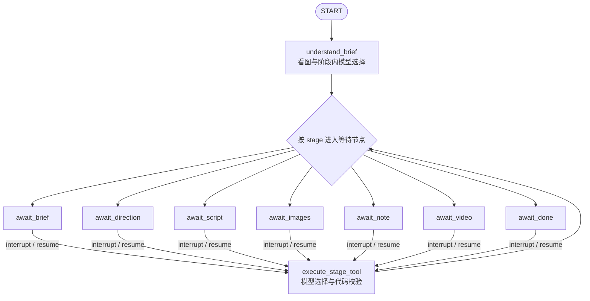

# 穿搭笔记智能体服务端

接口只遵循 [`docs/设计.md`](../docs/设计.md)，第二、三轮增量见其第 7、8 节。API、智能体、Worker 共用 PostgreSQL，媒体写入命名卷，支持同一项目断点续聊。默认 Mock，不需要模型凭证。实际测试和本轮费用见 [`FINAL.md`](FINAL.md)；本文的部署配置与命令不代表已经部署。

## 选择与边界

阶段之间由代码管理状态机，阶段之内由模型选择工具。`workflow.ALLOWED_TOOLS` 决定当前允许的工具；自由文本一次交给 DeepSeek，使用 `tool_choice="required"` 从整组工具中选一个，同时解析图片/方向 ID、生成完整内容和 `reply`。真实路径没有关键词路由，关键词只用于 Mock 假模型。模型选择后，代码仍校验阶段、项目归属、图片完成状态和输入参数。`chat.blocked_tool` 标出的越阶段请求同样经过代码门禁；模型无法绕过确认动作入队批量图片或视频。

显式 `choose_direction/approve_images` 等动作已经确定工具，模型负责写对应内容和回复。自由文本中的“出图”“做视频”只提出确认意图，必须收到独立 `confirm_script/confirm_video` 动作才入队。改图、脚本回退和笔记修订保留当前项目已有的图片版本；`images/note` 阶段改脚本会回到 `script` 等确认，`note` 阶段改图保持笔记和视频确认。

| 需求 | 实际实现及选择理由 |
|---|---|
| H1 跨进程、跨重启多轮状态 | LangGraph + PostgresSaver，`thread_id = project.id`，方向、脚本、确认点及对话历史持久化 |
| H2 原生人工确认与重放 | `interrupt()` 等待、`Command(resume=...)` 继续；确认校验在消耗暂停之前，稳定 uuid5/dedupe_key 与任务意图修复避免重放重复入队 |
| H3 付费门禁可审计 | `ALLOWED_TOOLS` 与明确 action 校验由代码执行，模型只在允许范围内做选择 |
| H4 中间结果提前展示 | `graph.stream(stream_mode=["custom", "updates"])` + `get_stream_writer()`，看图完成就推 `garments` 卡片，不等方向模型完成 |
| H5 Python、自托管、多供应商 | FastAPI + SQLAlchemy 2 + psycopg，ProviderHub 分别适配 DeepSeek、Qwen、万相；API、Worker、Postgres 可用 Compose 自托管 |
| H6 可恢复脚本历史 | `get_state_history()` 派生 `script_versions`，恢复动作只接受当前项目历史 checkpoint，保留旧图片并重新等待脚本确认 |

图在 API lifespan 编译一次，节点通过 `Runtime[GraphContext]` 获取本轮事务绑定的 Workflow，不把 Session 捕获在全局图中。每个项目的写对话用 advisory lock 串行化；不同项目可使用同一编译图。相关官方接口参考：[Runtime](https://reference.langchain.com/python/langgraph/runtime/Runtime)、[get_stream_writer](https://reference.langchain.com/python/langgraph/config/get_stream_writer)、[time travel](https://docs.langchain.com/oss/python/langgraph/use-time-travel)。

当前实际图如下；每次工具执行完成，按新阶段选择相应的等待节点。等待节点在 `interrupt()` 前没有外部副作用。



只有七个固定阶段时，手写循环配 JSONB 状态也足够，代码可能更短。LangGraph 在这里的价值来自可重启的原生暂停、提前发送卡片和 checkpoint 历史恢复；它也增加了重放、跨事务提交空隙和消息投影的维护成本。选型比较针对本任务，没有据未验证的版本差异断言其他框架做不到：

| 候选 | 本项目取舍 |
|---|---|
| 手写循环 + JSONB / events | 可完全掌控七阶段流程；需要自己实现暂停恢复、状态历史和中间事件，适合作为后续复杂度对照 |
| AgentScope | 保留为以 ReAct 消息循环为中心的第二候选；替换前需验证本项目的 Postgres 持久化、确认恢复和历史契约，本轮没有替换 PoC |
| OpenAI Agents SDK / Google ADK | 可以作为工具调用方案候选；本项目优先保留已有 Python 图和国产模型适配，没有验证替换后的完整 H1–H6 |
| CrewAI / Microsoft Agent Framework | 本任务是单个博主搭档，尚无多角色协作需求；本轮没有为更换编排框架引入额外集成工作，也不据此判断其当前功能或版本成熟度 |
| Dify / Coze 等平台 | 引入后需同时交付平台配置与运行环境；当前任务要求服务端代码逐行可审查，选择直接在仓库内控制流程、持久化和成本 |

## 状态、任务与媒体的真相

`brief/garments/directions/script/note/video` 等是领域状态；`incoming/turn_text/turn_cards/turn_jobs` 是持久化在 checkpoint 中的本轮输入输出通道，便于失败恢复与展示消息修复，不另作业务事实来源。脚本 `version` 在修改时递增，确认不增加版本；恢复保留历史编号。`state.script_versions` 每次从图历史派生，不维护另一份版本表。

生成任务的事实在 jobs 表。API 只决定与入队，独立 Worker 使用 `FOR UPDATE SKIP LOCKED` 领取，租约心跳与 attempts fencing 防止旧 Worker 覆盖新结果；稳定去重键处理重复确认。Worker 写任务结果、资产和主动消息，不与用户竞争 `Command(resume)`。用户仍可在生成期间聊天，下一轮和 `/state` 从 DB 更新图片/视频结果。若将来改为 `await_images` 等 Worker 恢复图，需要额外处理同时到来的用户输入，本轮没有采用。

图中的 stage 表示对话决策，`project.stage` 是供项目列表使用的投影。例如视频在 Worker 完成后，`GET /state` 可以把展示阶段投影为 `done`，随后对话也会读取视频结果。`/state` 与 `/messages` 会尝试 `pg_try_advisory_xact_lock`：拿到锁时修复 checkpoint 与业务事务之间缺失的任务/消息；拿不到则跳过修复，直接读取已提交状态，不等待正在跑模型的对话锁。这是带自愈投影的读接口。

展示消息保留完整卡片和稳定 ID，`card.id = project:type`；历史消息中的同一张卡可以有多个快照，App 工作台用后到的同 ID 卡覆盖。Worker 在整批图片完成、自动修复完成或视频完成时写 assistant 消息，包含数量与还原分摘要；`state.last_message_id` 变化后客户端可刷新消息列表。

媒体下载供应商临时 URL 后转存本地卷并保留 parent 版本链。HMAC 签名媒体 URL 在同一个六小时窗口内稳定，默认至少有效 24 小时；持有地址即可读取，App 图片组件无需 bearer token。项目、素材引用和任务仍按账号隔离。Alembic 管理业务表，API 启动时迁移，PostgresSaver 在 lifespan 初始化 checkpoint 表；备份需同时保留数据库与媒体卷。

## 还原度、预览与生成声明

每个方向自动入队一张灵感预览图，方向卡通过 `preview_status/preview_url` 更新。预览是设计约定的低成本自动层：真实模式每张按当前估价约 0.5 元，首次 2–3 个方向约 1–1.5 元；重新生成不同方向会产生新的预览费用，稳定去重键只复用相同内容的任务。预览不经过脚本确认，批量正式出图和视频仍分别要求确认；Mock 预览零模型费用。

正式出图 prompt 包含衣服看图结果（品类、颜色、面料），明确要求保留版型、颜色、纽扣、口袋、logo。改图参考父图和最多两张原衣服图，总参考数不超过三张。衣服分析独立缓存到 `Asset.analysis`，后续方向失败不丢已付费的看图结果。

Worker 对正式图片使用 qwen3-vl-plus 比较原衣服，记录 `fidelity.score/diffs/auto_fixed`；分数低于 60 时按差异自动改一版，每张最多一次。自动修复仍可能失败或留下差异，分数是模型质检估计；视频 prompt 要求人物面部和衣服保持不变，不能保证每帧身份完全一致。

生成图片保存为带可见“AI生成”角标和 AIGC/Source/Model 元数据的 PNG；视频请求启用 watermark。`note.ai_label` 提示发布时勾选平台 AI 内容声明，`state.cost_cny/note.cost_cny` 来自调用账本。角标和提示是产品披露，不替代发布平台自己的声明流程。

## 本地启动

需要 Docker Compose v2；本机脚本需要 Python 3.11 和 [uv](https://docs.astral.sh/uv/)。在当前 `server/` 目录执行：

```bash
docker compose up -d --build
curl -fsS http://localhost:18080/api/health
uv sync --frozen --dev
uv run python scripts/e2e.py --mode mock
uv run python scripts/restart_e2e.py --mode mock
uv run python scripts/experiments.py --output artifacts/experiments-fix1.json
REQUIRE_INTEGRATION=1 uv run pytest -q
uv run ruff check .
```

固定 Compose 项目名 `outfit-agent-server`。API 默认只绑定 `127.0.0.1:18080`，PostgreSQL 只绑定本机 `18432`。不要操作其他项目的容器。重启脚本和 E1 只执行本目录的 `docker compose restart api`；停止本项目用 `docker compose stop`，无需删除媒体卷。

OpenAPI 静态导出位于 [`openapi.json`](openapi.json)，运行中还可查看 `http://localhost:18080/docs` 和 `/openapi.json`。SSE 事件为 `token/card/job/trace/done/error`。看图完成的 garments 卡片提前发送，完成后仍会发送完整卡片并持久化展示消息；同 ID 卡片覆盖即可。文本是在完整工具参数通过校验后分片发送，尚未逐 token 透传上游工具参数；等待期间发送 keepalive。客户端重连可读 `/messages` 与 `/state` 恢复工作台。

### 管理端

管理端与 API 使用同一容器：在服务器启动进程环境设置 `ADMIN_TOKEN` 后重新创建 API 容器，访问 `/admin` 输入该口令。默认空值关闭页面和全部 `/api/admin/*`（404）；`.env.example` 仅保留空值。不要将口令写入仓库或命令历史。管理登录签发独立会话，浏览器仅将会话保存在当前标签页的 `sessionStorage`，退出即清除；App JWT 无法访问管理接口。公开环境使用 HTTPS。

五个页面提供总览、按模型/用户/天聚合的用量及 CSV、模型与配额、队列、用户管理。模型从内置候选中选择，配置写入 `app_settings`，API/Worker 下次读取直接生效，无需重启。禁用账号后登录与所有写接口返回中文 403；启用或改层级在下次请求生效。排队任务可取消，失败任务可手动重试；取消在 App 侧仍显示既有 `failed` 状态，管理端单独标注“已取消”。

每日预算按北京时间自然日统计账本估价（含尚未结算及失败预留），默认免费层 12 元、专业层 120 元、全局 1200 元。用户或全局到限时拒绝方向预览、批量出图、改图及视频，并返回中文 SSE 错误；每日预算不阻止对话。可用模型按用户当前层级校验。原真实模式 `MODEL_BUDGET_CNY` 仍是数据库全历史总额的外层安全上限，真实调用仍受其约束；Mock 账本费用为零，通过临时将预算设为零及隔离账本测试验证每日拒绝。

验收见 [`ADMIN.md`](ADMIN.md)，断点见本地 `PROGRESS.md`；截图在 `artifacts/admin/`。本地验收只使用临时管理口令和 Mock，不需要真实模型密钥。

### 局部编辑、指令核对与图片引用

`edit_image` 动作可额外带 `region: {x,y,w,h}` 或 `mask_strokes: {brush,strokes}`，两者互斥；都省略时整张编辑。坐标为相对原图的 0–1 值，笔刷相对短边，支持单点、多段轨迹和贴边涂抹。API 在入队前检查越界、空轨迹、非法数值以及不足 16 像素的极小区域，并返回中文错误；不同选区参与任务去重。

局部流程采用 Pillow：轨迹蒙版 → 外接框扩边（至少 16px、选区长边 20%）→ 原衣服参考加裁剪图 → 只生成裁剪块 → 蒙版内羽化贴回。蒙版外 alpha 严格为零，PNG 保存时不重复绘制角标，原有声明角标区域受保护，因此选区外逐像素不变。裁剪参考短边不足 240px 时上采样，极端长宽比用上下文填充；模型输出按裁剪画布映射回原尺寸。[万相官方接口](https://help.aliyun.com/zh/model-studio/wan-image-generation-and-editing-api-reference)有框选参数，但未承诺任意轨迹和外部像素一致；本轮采用契约第 8.3 节的可验证方案，没有额外付费对照原生框选。

每次整图或局部编辑都用 Qwen 对比前后两张图，检查原始指令，返回 `image.edit_check = {passed,reason}`；局部版还返回归一化 `image.region`。未达到要求时加强指令纠正一次，仍未做到则保留图并主动播报具体原因。指令纠正、低还原分纠正及供应商可重试错误共享每个编辑任务最多两次图片请求的额度，计数在发送前持久化。核对服务不可用时诚实返回未确认，不因质检异常重复付费；纠正失败时保留已取得的首次图片。所有生成、编辑和还原评分都明确区分衣服与可拆纸牌/贴纸，不能把标签转为 logo 或要求补齐标签文字。

`POST /messages` 可带 `refs: [image_id]`，只接受当前项目已成功的正式图片；引用的具体版本、镜头、还原分和改图检查进入模型上下文。模型解析“这张袖口卷起来了，放下来”，代码继续校验结果归属和阶段。`GET /messages` 读回相同 `message.refs`，数据库迁移 `0003` 为历史消息补空列表，checkpoint 恢复也保留引用。

### 验证脚本与断点

`scripts/e2e.py` 通过 HTTP 运行完整链路：注册、登录、上传两件衣服和模特、方向及预览、脚本、自由文本“换成通勤风”、确认生成至少四张正式图片、整张改图、涂抹局部改、引用图片后自由文本改图、选图写笔记、单独确认五秒视频、下载媒体。Mock/real 使用同一脚本，只切换服务器配置与 `--mode`；模式和 `/health` 不一致时拒绝执行。

素材来自 [`fixtures/README.md`](fixtures/README.md) 所述仓库自生成参考图裁片，无外部图片依赖。Mock provider 只产生本地媒体及结构化文本，不调用模型网络。每步耗时、项目 ID、任务和卡片摘要写到 `artifacts/*.json`，不保存 bearer token、密码或媒体签名。失败证据保留已完成步骤；默认重新运行创建独立账号和项目。

```bash
uv run python scripts/e2e.py --mode mock --output artifacts/mock-review.json
uv run python scripts/restart_e2e.py --mode mock --output artifacts/restart-review.json
uv run python scripts/experiments.py --output artifacts/experiments-review.json
```

`experiments.py` 限制为本项目本机 Mock 栈，输出 E1 重启续聊、E2 重复确认/改图不重复入队、E3 越阶段被拒、E4 通勤版改写后恢复历史版并确认的结果表和证据。E1 会重启本项目 API，其他实验复用同一新建的测试项目。

真实模式的预览若发生供应商断连，会保留失败状态与费用预留，闭环验证继续使用其余成功预览，避免为通过检查重复提交结果未知的付费请求；Mock 要求所有预览成功。每个预览都记录终态，正式出图仍要求所需图片全部成功。

复用真实验证进度时，先在当前进程环境设置 `E2E_USERNAME/E2E_PASSWORD`，不要把密码写进命令历史。脚本会注册该固定账号，已存在则登录；证据只记录用户名和项目 ID。失败后读取证据里的 `project_id`，在同一凭证环境执行：

```bash
uv run python scripts/e2e.py --mode real --resume PROJECT_ID --output artifacts/real-review.json
```

续跑按当前阶段复用脚本、出图/改图任务、笔记和视频，不重复确认已有付费任务；活跃任务等待，已成功 v2 和视频复用。同一路径已有证据保存在 `previous_runs`。终态失败任务会停止，不绕过重试上限自动重复付费。未知结果的已发出图片请求也不自动重提。

第三轮真实图片验证另有 `scripts/verify_edits.py`：只允许本机 18432 上 `outfit_fix2_*` 专属数据库，图片保存到本 worktree 的媒体目录，不切换常驻 Mock 服务。预先创建该专属数据库并执行迁移，在当前进程注入模型凭证、`MOCK_PROVIDERS=0`、`MODEL_BUDGET_CNY=8`、对应 `DATABASE_URL` 和 `MEDIA_DIR` 后运行：

```bash
uv run python scripts/verify_edits.py --name original --output artifacts/real-edits.json
# 先目检原图，再按实际袖口位置填写归一化选区。
uv run python scripts/verify_edits.py --name cuff --region 0.30 0.31 0.13 0.12 --output artifacts/real-edits.json
uv run python scripts/verify_edits.py --name tuck --output artifacts/real-edits.json
uv run python scripts/report_usage.py --output artifacts/usage-real-edits.json
```

该脚本直接使用正式 Workflow/Worker/Provider，在自己的运行中任务行上验证真实模型；HTTP/鉴权/消息持久化由 Mock e2e 覆盖。每步先保存项目和任务 ID，完成后保存图片、检查结果及前后对比；局部步骤额外断言蒙版外改变像素数为零。续跑相同输出复用成功任务，发现已发出但结果未知的请求会停止。首次标签失败样本及最终样本分别留存，所有真实实验调用都计入本轮费用。

pytest 的 HTTP 集成用例要求本机 Mock 栈；默认没有栈会跳过，`REQUIRE_INTEGRATION=1` 强制可用。测试只允许 `localhost/127.0.0.1:18080`。迁移测试只在本机 `18432` 新建随机 `outfit_test_*` 空库、执行 Alembic 和核对业务表，最后删除自己创建的测试库；业务数据库不清理。自定义数据库口令时，测试进程应注入相同 `TEST_DATABASE_URL/JWT_SECRET`。

### 第四轮局部改对照与断点

正式局部改保留最多两张衣服参考，最后一张始终是裁剪画布；扩边由选区长边的 20% 增至 60%，不扩大用户蒙版。提示补充可见目标状态，并保留用户原话及未要求改变的属性；纯调色请求只改颜色或亮度。带完整原图参考的实验产生了人物拼贴，未采用。[万相 2.7 官方接口](https://help.aliyun.com/zh/model-studio/wan-image-generation-and-editing-api-reference)说明 2K 编辑输出比例跟随最后一张参考图，因此不能把整图放在裁剪图后面。[多图编辑指南](https://help.aliyun.com/zh/model-studio/wan-image-edit)也要求图号与输入顺序一致。目标状态提示是实验策略，不构成成功保证。

合成先以同位置的低频 RGB 差校正边缘色偏（单通道偏移限于 ±48/255，校正向内衰减），再以蒙版内 smoothstep 羽化；中心编辑不受校色影响。选择这种方法是为了限制过渡范围并严格保证蒙版外像素不变，避免全图融合改动其他区域。无足够内部空间的细分支回退受限羽化以保留编辑能力，平滑程度不等同于宽选区。生成图片使用随目标尺寸 4× 超采样的中文字体，来源、许可与重建方式见 [app/fonts/README.md](app/fonts/README.md)；元数据与继承角标保护保持不变。

`scripts/compare_local_edits.py` 复用上一轮保留的两张本地样本，分别测袖口、塞腰和胸牌；三个方案各只请求一次，不触发自动纠正。`baseline` 是旧上下文和旧提示，`candidate` 加完整原图参考，`context` 是最终采用的较大上下文与目标状态提示。A/B 固定原图、指令和蒙版，组合策略的差异不能归因于单一因素；三样例不能推导总体成功率。输入样本在 `artifacts/`，新检出仓库需先准备对应样本，测试本身不依赖这些历史文件。

仅在已通过钥匙串注入个人模型凭证的进程内运行，常驻 API/Worker 保持 Mock：

```bash
MOCK_PROVIDERS=0 MODEL_BUDGET_CNY=5 uv run python scripts/compare_local_edits.py --mode real --phase check
# 完成的检查可重复运行，新增模型调用为零。结果未知的 started 状态会停止，不能盲目重提。
# 下面的接缝重放完全离线，使用本轮保留的同一个原始模型响应比较新旧合成。
uv run python scripts/verify_seams.py --raw artifacts/local-edit-fix3-cuff-baseline-raw.png --region .295 .31 .145 .13 --context-ratio .2 --output artifacts/seams-fix3-cuff-baseline.json
```

真实实验强制共用 `artifacts/local-edit-fix3.json` 和同名 SQLite 费用账本，缺失任一会停止；费用包含失败与弃选方案。每次生成/核对先写断点，保留输入哈希、参考图哈希、指令、裁剪参数及 raw 输出；配置变化拒绝混用。`--phase generate` 可只保留 raw，`--phase check` 按已保存提示核对；`--variant context` 只测选中策略。接缝指标减去原图天然梯度，同时报告 2–8px/16px 内环带残差，不能仅靠边缘权重为零来宣称没有接缝。

## 博主档案与项目清理

`GET /api/me` 和登录/注册返回的 `user` 增加 `tier`、`daily_budget_cny`、`today_cost_cny`、`profile`。预算与管理端共用实时层级设置，花费按北京时间自然日汇总账本，包含未结算或失败的保守预留。

`PATCH /api/me` 支持昵称和档案部分更新，例如：

```json
{"nickname":"小夏","profile":{"model_asset_ids":["本人照片资产编号"],"height_cm":168,"style_notes":"喜欢松弛感，不穿高跟鞋"}}
```

未传字段保留；档案内 `height_cm/body_notes/style_notes` 传 `null` 清除，`model_asset_ids: []` 清空照片。昵称与档案本体不接受 `null`。照片最多 20 张且不可重复，只能选本人上传的 `kind=model`；身高范围为大于 0、不超过 300cm，体型和风格文字各最多 2000 字。新项目省略或传 `null` 的 `model_asset_id` 时选档案中第一张有效照片，显式照片可覆盖；没有档案照片仍使用原默认模特流程。每轮读取当前档案，旧项目也会收到最新偏好；Mock 与真实模型的方向和脚本均使用它。

删除项目会在同一数据库事务中删除消息、任务、所有 LangGraph checkpoint namespace 和生成资产，保留项目删除标记与费用账本。上传素材保留，可继续在其他项目使用。Worker 提交结果与删除共用项目行锁：尚在生成的任务返回后不会写回；已经提交的生成文件也会被清理。文件删除在提交后执行，失败意图保存在 `app_settings` 的清理队列，由 Worker 轮询重试。已提交给上游的请求无法撤回，仍可能产生费用；删除不返还已发生或未知的预留费用。

## 请求防护与日志

注册和登录分别按客户端 IP 限流，上传和对话分别按用户限流。使用数据库原子计数，API 多进程共享固定时间窗口；默认窗口 60 秒，注册/登录各 120 次、上传 60 次、对话 120 次。超过上限返回中文 `429` 和 `Retry-After`，无效登录也计数；上传在读取请求体前完成鉴权及限流。可通过 `RATE_LIMIT_REGISTER/LOGIN/UPLOAD/MESSAGES` 和 `RATE_LIMIT_WINDOW_SECONDS` 调小阈值，Compose 已透传这些变量。固定窗口边界可能短时允许两倍窗口额度。应用按 ASGI 客户端地址识别 IP，公开部署需让可信反向代理覆盖转发头，并正确设置 Uvicorn 的可信代理范围。

上传按实际文件内容解码，仅接受 JPEG、PNG、WebP、HEIC；单文件最多 15 MiB、最长边最多 6000px。体积或尺寸超限返回中文 `413`，不支持或损坏的内容返回中文 `415`。HEIC 经 [Pillow HEIF 插件](https://pillow-heif.readthedocs.io/en/latest/pillow-plugin.html) 解码后转为 JPEG，便于 App 和模型读取；其他三类保留上传字节。`MAX_UPLOAD_BYTES/MAX_UPLOAD_EDGE` 可调低，不可超过契约上限。multipart 总请求另留 64 KiB 包装额度，流式上传也有界，临时文件操作在线程池进行。

每个响应回传 `X-Request-Id`，沿用客户端 1–128 个可打印 ASCII 字符的 ID，非法或缺失时生成；CORS 暴露此响应头。请求 JSON 日志记录请求 ID、用户、项目、路由模板、完整响应耗时及状态；模型 JSON 日志记录模型、耗时、估算费用及结算状态。日志不记录请求正文、认证头或 URL 查询参数，异常链进行凭证脱敏。Worker 模型调用也带用户/项目，独立任务没有 HTTP 请求 ID。

管理端总览增加最近 24 小时请求量和错误数，来源为持久化 `request_events`，重启及多进程共享。错误包含 HTTP 状态 ≥400 或 SSE `error`，每个请求只计一次。统计含健康检查、媒体和管理请求，以响应结束/断连时刻计入；断连后继续执行的对话错误由模型/任务日志记录，不追改已结束的 HTTP 记录。观测表和限流身份行目前没有自动保留期清理，小规模演示可直接使用，长期运行需配置数据库保留策略。

## 持续集成与本轮复验

[`../.github/workflows/ci.yml`](../.github/workflows/ci.yml) 使用 [PostgreSQL service](https://docs.github.com/en/actions/tutorials/use-containerized-services/create-postgresql-service-containers)，执行服务端冻结依赖安装、ruff、迁移、Mock API/Worker 与强制集成 pytest；App 使用 Node 22，执行 `npm ci`、typecheck、lint、单测。不依赖模型凭证。

```bash
uv sync --frozen --dev
uv run ruff check .
REQUIRE_INTEGRATION=1 uv run pytest -q
uv run python scripts/wait_health.py
uv run python scripts/e2e.py --mode mock --output artifacts/ops/mock-e2e.json
uv run python scripts/experiments.py --output artifacts/ops/experiments.json
uv run python scripts/ops_acceptance.py
# 仓库根目录：actionlint .github/workflows/ci.yml
# app/ 目录，Node 22：npm ci && npm run typecheck && npm run lint && npm test
```

本轮交付见 [`OPS.md`](OPS.md)，断点保存在本地 `PROGRESS.md`。`scripts/verify_profile.py --run` 只发送两次真实 DeepSeek 文本调用，固定独立 SQLite 账本先记录 `started`，未知结果拒绝重发，成功结果复用；总保守预留不超过 0.10 元。密钥仅通过钥匙串注入子进程环境，常驻 Mock 服务不切真实模式。估价按 [DeepSeek 官方峰值价格](https://api-docs.deepseek.com/quick_start/pricing/) 和保守汇率计算，实际扣费以供应商账单为准。

## 配置与真实费用

配置只从进程环境读取，应用不自动加载 `.env`。Compose 可用 `.env.example` 查看无密钥示例；实际模型密钥、数据库密码和 JWT secret 只注入启动进程，不写文件或提交。模型密钥按任务约定从个人钥匙串注入，不打印到终端、日志或证据。

| 变量 | 默认值 / 用途 |
|---|---|
| `MOCK_PROVIDERS` | `1`；全部模型调用改为本地实现 |
| `DATABASE_URL` | 本机开发 `postgresql+psycopg://…@localhost:18432/outfit`；Compose 内部 `postgres:5432` |
| `POSTGRES_PASSWORD` | 本地默认 `outfit`；公开部署必须替换 |
| `JWT_SECRET` | 本地开发固定值；生产使用随机值，API/Worker/测试签名保持一致 |
| `PUBLIC_BASE_URL` | `http://localhost:18080`；App 可访问的绝对媒体根地址 |
| `MEDIA_DIR` | 开发 `data/media`；Compose `/data/media` 命名卷 |
| `API_PORT` / `POSTGRES_PORT` | `18080` / `18432` |
| `API_BIND` | 默认 `127.0.0.1`；生产也只绑定 loopback |
| `DASHSCOPE_API_KEY` / `DEEPSEEK_API_KEY` | 真实模式通过进程环境注入 |
| `TEXT_MODEL` / `VISION_MODEL` | `deepseek-flash` / `qwen3-vl-plus` |
| `IMAGE_MODEL` / `VIDEO_MODEL` | `wan2.7-image-pro` / `wan2.6-i2v-flash` |
| `MODEL_BUDGET_CNY` | 默认 `12`；本数据库全部调用累计估价上限，包含尚未结算的预留，不会随会话或重启归零 |
| `ENVIRONMENT` | `development`；公开部署设 `production` |
| `CORS_ORIGINS` | `*`；可设逗号分隔网页来源，原生 App 不受浏览器 CORS 约束 |

启动真实模式前先导出账本基线；本轮已保存的 `artifacts/fix1-baseline-usage.json` 是 22 次历史调用、累计估价 7.104079 元。本轮费用按结束累计减去这份基线计算，不把第一轮费用混入；模型请求先独立提交预留，失败或结果未知时保留保守估价。数据库总预算闸须设为“基线 + 本轮 12 元停止线”，此基线对应 19.104079 元。任务的本轮外部硬上限为 15 元，12 元开始停止新调用并收尾；预留会使调用提前被拒，不能靠重启绕过。

下面只在已注入个人模型密钥的当前终端执行。若复测时账本已有新调用，先重新导出基线再计算总阈值，不清空账本：

```bash
uv run python scripts/report_usage.py --output artifacts/recheck-baseline-usage.json
export MODEL_BUDGET_CNY="$(uv run python -c 'import json; from decimal import Decimal; print(Decimal(json.load(open("artifacts/recheck-baseline-usage.json"))["estimated_cny"]) + 12)')"
export MOCK_PROVIDERS=0
docker compose up -d --force-recreate api worker
uv run python scripts/evaluate_intents.py --output artifacts/intents-review.json
uv run python scripts/e2e.py --mode real --output artifacts/real-review.json
uv run python scripts/report_usage.py --output artifacts/usage-review.json
```

`evaluate_intents.py` 预先声明 30 句问句及预期工具/目标，覆盖七阶段、模糊指代、反问、跑题、越阶段、改图和恢复历史。它直接调用文本供应商，不创建图片或视频任务；要求进程内 `MOCK_PROVIDERS=0/DEEPSEEK_API_KEY` 与本项目数据库配置。结果逐句写入，失败保留分母，准确率低于 90% 时退出非零。重测使用新文件保留原结果，不把 Mock 结果当真实模型准确率。

同阶段不同项目的回复可另用 `--replies-only --output artifacts/replies-review.json` 检查，增加两次文本调用，验证两个不同合作需求收到不同回复。

账本记录模型、耗时、计费单位和估价，最终金额以供应商账单为准。代码当前保守估算图片 0.5 元/张、720P 带声视频 0.3 元/秒和文本/视觉 token 费用；预览、正常出图、用户改图、低分自动修复、质检都计入项目成本。生成前可据此估算一次闭环，而不能只数最终选中的图片。真实完成项目可用固定验收账号环境运行 `uv run python scripts/review_note.py --mode real --project-id PROJECT_ID`，抽查文案修订不新增媒体任务（仍调用一次文本模型）。

真实验证完成后设置 `MOCK_PROVIDERS=1`，用基础 `compose.yaml` 重新创建 API 和 Worker，再确认 `/api/health` 的 `providers.mock=true`，避免日常测试产生费用。

## 生产配置：宿主 nginx HTTPS

本轮只提供配置，不连接服务器、不执行远程部署。目标由宿主 nginx 提供 `https://47.97.153.127:8443`，应用只监听 `127.0.0.1:18080`。[`deploy/compose.production.yaml`](deploy/compose.production.yaml) 固定真实模式、生产环境与公开媒体根地址，Worker 两副本；基础 Compose 已为 API、Worker、Postgres 设置 `json-file` 日志轮转（20m × 3）。

以下步骤只用于个人或已明确授权的新环境，由部署负责人执行；数据库/JWT/模型凭证预先放进启动进程环境：

```bash
export ENVIRONMENT=production
export PUBLIC_BASE_URL=https://47.97.153.127:8443
export API_BIND=127.0.0.1
# MODEL_BUDGET_CNY 按已有账本与批准的部署预算设置。
docker compose -f compose.yaml -f deploy/compose.production.yaml config --quiet
docker compose -f compose.yaml -f deploy/compose.production.yaml up -d --build --scale worker=2
```

宿主 nginx 的现有 TLS 入口代理到 `http://127.0.0.1:18080`，关闭 SSE buffering、允许 16 MB 请求体，并为长连接设置足够 read timeout；证书、TLS server 和宿主 nginx 不在这个 Compose 中。App API 根地址是 `https://47.97.153.127:8443/api`，媒体使用返回的绝对签名 URL。部署后由负责人检查公网健康、SSE、媒体下载及容器重启后的持久性；数据库和 API 端口不直接向公网发布。

自有域名新环境也可选择现存 [`deploy/compose.caddy.yaml`](deploy/compose.caddy.yaml) 与 [`deploy/Caddyfile`](deploy/Caddyfile)：设置 `DOMAIN/PUBLIC_BASE_URL`，在正确 DNS 和 80/443 可用后启动 Caddy overlay，走内部 `api:8000` 自动管理证书；这属于替代部署方案，不与宿主 nginx 生产 overlay 混用。此仓库提供管理端和恢复码找回账号，未内置对象存储和多机部署。


## 第六轮：回复过程与文字重写

assistant 消息新增 `trace` 和 `can_regenerate`；SSE 在 `done` 前发送 `trace`，与 `/messages` 读回一致。对话 trace 只合计当前调用的账本行，Worker 按 `job_id` 汇总任务与自动修复的调用，失败和未知结果保留预留费用，Mock 实际费用为 0。迁移前的历史消息未记录追踪，保留 `trace=null`、`can_regenerate=false`。

`state.pending_action.estimated_cost_cny` 按 `app/costs.py` 与账本共用的出图 ¥0.50/张、5 秒视频 ¥1.50 计算；脚本确认额外计 20% 自动修复预留。预估不含另行记录的文字/看图费用，最终以账本为准。`state.budget` 的层级、日额度、今日花费、剩余额度与 `/me` 和管理配置共用上海自然日账本；剩余为用户日额度扣减，不代表全局预算或模型权限。

`{action:{type:"regenerate_reply",message_id}}` 仅调用文字模型，以同 id 覆盖该回复文字并更新其 trace；保留卡片、任务、脚本和阶段，重新发送 `token/trace/done`，不插入用户消息。文字调用正常记账，没有新增图片/视频费用；创建了付费任务的回复和 Worker 通知返回中文拒绝。checkpoint 同步保存覆盖结果，重启恢复后不会回退文字。方向阶段发送“换一组方向，保留我刚才说的偏好”由模型选工具，继续考虑历史偏好并创建新方向预览。

零费用复验：

```bash
uv run pytest -q tests/test_trace_http.py tests/test_trace_review.py tests/test_trace_budget.py tests/test_worker_trace.py tests/test_regenerate_provider.py tests/test_direction_refresh.py
uv run python scripts/verify_trace.py --mock --regenerate
```

真实小额验证使用 `scripts/verify_trace.py --run --regenerate`，须仅向子进程注入钥匙串中的两个模型 key。脚本限制官方端点、两张新预览、总预留 ¥1.50，独立保存业务账本与调用断点；已有成功结果复用，`started` 未知结果拒绝重新请求。不能清空或换输出目录来重提未知的图片请求，失败预留须计入当轮总限额。

## 第七轮：参考图与封面锚点

建项目可选传 `reference_asset_ids`，最多三张、不重复，仅接受当前用户上传的 `kind=reference` 资产；项目读回包含同名字段，旧项目迁移后为 `[]`。看图分别分析场景、光线、构图、氛围、配色，整理进 brief 和上下文，并发送 `references` 卡片。方向、脚本、预览和正式出图沿用这些风格；没有参考图时不增加风格分析调用或卡片。回读历史参考卡会刷新签名 URL；参考分析缓存按 Mock/真实模式及当前视觉模型隔离，切换后重新分析。

确认脚本后，首镜先出封面，其余镜头保留在持久队列中等待；封面成功后，所有剩余镜头可由多个 Worker 并行领取，输入保留本人、衣服及封面。封面终态失败或取消时，其余镜头退回无锚图生成；暂态重试继续等待。封面若触发自动修复，等待修复终态，成功采用修复版，修复失败采用原成功封面。`image.anchor_id` 指向实际使用的封面图片 ID。依据[万相官方规格](https://help.aliyun.com/zh/model-studio/wan-image-edit)，2.7 支持最多九张输入图，可完整传入现有镜头的衣服、本人照片和锚图。

还原检查在有本人照片时返回 `fidelity.person_score`，有封面时返回 `anchor_score`，由看图模型比较实际图片；没有对应参考时省略该字段。主动完成消息附一致性摘要。圈选改图仍以最后一张裁剪图为唯一画布，有锚点时将其放在裁剪前，风格要求和蒙版外像素保护继续保留。分数是模型判断，不能替代人工审图。

```bash
uv run python scripts/verify_anchor.py --mock
# 已有真实结果完全离线重放，无需模型密钥：
uv run python scripts/verify_anchor.py --run --offline
```

首次真实验证仅在已将个人钥匙串凭证注入子进程后运行 `scripts/verify_anchor.py --run`。它使用独立 SQLite 业务库与请求账本，固定 `evidence/anchor-real`，R1/R2 各不超过 2 元、总闸 5 元；每次调用先持久化 `started`，未知结果拒绝重提，成功结果复用，离线模式不新增预留。常驻服务始终保持 Mock。真实验证只执行每组一个方向预览和三镜头，未运行的预览在实验私有库标为失败；其余镜头的并行领取由 PostgreSQL Mock 测试验证。夜晚参考是脚本原创的霓虹街景插画，风格会相应影响结果。结果、调用账本和对比图见 `evidence/anchor-real/anchor-real.json`，交接结论见 [ANCHOR.md](ANCHOR.md)。

## 第八轮：改图结果可信闭环

`approve_images` 遇到 `edit_check.passed=false` 的成功图片时返回 `unverified_image`，消息包含镜头号和核对原因。用户确认后在同一 action 中传 `accept_unverified: [image_id]`；笔记的 `accepted_unverified_ids` 保存实际采用的未通过图片，普通文字修订保留该记录，重新选图重新确认。视频首帧仍须来自当前 `note.image_ids`，并通过同样的采用校验；质检未通过仍保持任务 `succeeded`，不会自动重新付费。

文案上下文逐图分开 `requested_change` 和 `confirmed_visual_facts`。只有核对明确通过或本次手动采用的修改进入事实；其余沿用原衣服和原画面描述。提示词要求较晚确认的修改覆盖较早描述，禁止将未确认修改写成已完成事实。note 阶段重新 `approve_images` 会重写笔记并更新选图顺序。

`edit_image` 可传非空字符串 `attempt`（最多 64 字符）。同一父图、指令、选区和 attempt 返回原任务，SSE `job` 事件在任务字段同级给出 `reused=true`；新 attempt 创建新任务并给出 `reused=false`，仍走原预算和限流。显式 attempt 重放不再调用文字模型，预算已耗尽也可取回已有任务；不传 attempt 保留旧去重键。`attempt` 仅是客户端提交标识，与 Worker 的队列尝试次数无关。

新方向卡片及历史卡片读回新增 `regenerate_estimate_cny`，由 `costs.py` 按三张预览保守估算（当前为 ¥1.50，下一组实际为 2–3 张）；不含另计的文字和看图费用。新增数据沿用现有 JSON/checkpoint，无需新增数据库列或迁移。

零费用验证：

```bash
uv run ruff check .
REQUIRE_INTEGRATION=1 uv run python -m pytest -q
uv run python scripts/e2e.py --mode mock --output artifacts/round8/mock-e2e.json
```

## 第九轮：点数与一键出片

用户端以点数显示，`costs.POINTS_PER_CNY = 10`，即 10 点 = 1 元；`points(cny)` 保留一位小数。图片估算 5 点/张、5 秒视频 15 点；脚本确认预留 20% 自动修复，换一组方向按三张预览估算 15 点。预算、确认报价、消息追踪、卡片和 `/api/me` 都在旧 `*_cny` 字段旁增加 `*_points`，历史消息读回同样补齐。账本、预算门禁和管理端继续按元计算，Mock 报价相同、实际费用为 0。

`GET /api/projects` 的每个项目增加 `progress`。状态来自当前阶段和持久队列，不需要进入项目或轮询详情来刷新：首页可直接显示“出图中 2/3”“等你确认脚本”“笔记已就绪，等你看”“全套已出好”等短句。`running` 为当前批次尚未完成的排队/运行任务数，`total` 为该批次任务数，`updated_at` 取项目与任务最近更新时间；旧批次失败不会把新批次的出图进度覆盖。

`POST /api/projects` 可传 `mode: "auto"` 与最多 6 个、各 12 字内的 `style_tags`；默认仍是 `guided`，brief 原文不改。迁移 `0010` 为旧项目补 `guided / []`。`GET /api/quotes/auto` 用同一份 `costs.py` 计算三张预览、三张正式图（含 20% 修复预留）、一条视频，当前合计 48 点；这是标准三镜头报价，用户明确增加镜头时按实际任务记账。

| auto.step | 自动动作与等待条件 |
|---|---|
| directions | 看衣服/参考图并提方向，等待当前预览完成 |
| script | 选唯一 recommended 方向（缺省第一项），写脚本 |
| images | 自动确认脚本，沿用封面先出、其余镜头并行及原队列重试 |
| note | 等本批图和自动修复结束，按脚本顺序采用通过核对的 v1，写笔记 |
| video | 以所选封面 v1 作首帧，自动确认 5 秒视频 |
| done | 视频成功，发布完成消息并将 auto.active 设为 false |

Worker 每次队列事务提交后推进一步；队列空时也扫描 auto，服务重启后能继续。每步使用与对话相同的项目决策锁，调用现有 action 和预算校验，不增加 `ALLOWED_TOOLS`，不改变 guided 的确认语义。步骤和主动消息写 checkpoint，任务仍用原稳定 ID / intent 恢复；业务事务回滚后不会重复入队。auto 期间 `pending_action` 始终为 null，消息仍可正常聊天。

任务失败、预算拒绝、文本/核对模型错误均停在当前阶段，转 `guided` 并主动说明阶段、原因、接下来可做的操作；已发生的费用不抹除。`POST /api/projects/{id}/mode {"mode":"guided"}` 也使用项目决策锁，当前一步结束后交回，下一个确认点等待用户；已排队和运行的任务继续。`state.auto` 保留已开始的步骤、开始时间与估算点数，接手后 active=false。

摄影扩写在预览及正式图入队前以确定性规则完成，不增加模型调用：12 个共用中文风格词分别映射焦段、光线、构图、抓拍瞬间与质感；多词以首个为主、其余补充质感。参考图分析中的构图和光线优先覆盖默认摄影语言。扩写保存在 `job.payload.photo_prompt`，并追加到原出图 `prompt`，管理端队列可展开查看；原衣服还原描述、封面锚点、普通改图和局部像素逻辑保留。

例：镜头“街角走动”、风格“街头胶片”会扩写为“焦段：35mm；光线：街道自然光；构图：低角度、路人前景遮挡、不居中；瞬间：过街回头的抓拍瞬间；质感：明显胶片颗粒、轻微动态模糊、真实皮肤纹理、不磨皮。不要棚拍白底、不要对称居中、不要塑料感皮肤。”若有霓虹参考图，则使用参考的霓虹光线与构图。这里按设计 §14.3 保留明确否定句“不要棚拍白底”，不将它作为正向摄影要求。Mock 验证规则、传递链路和衣服保护，成图观感需另行真实样张验收。

## 第十轮：账号闭环

本轮遵循设计第 15 节。新增路由和请求/响应模型位于 `app/account.py`；原注册处理迁入该模块，登录返回格式和旧请求的行为保留。三份法律正文位于 `app/legal/`，统一版本 `2026-10-21`，面向“衣序（演示版）”，无需登录即可查询。

| 接口 | 请求 | 成功响应 |
|---|---|---|
| `GET /api/legal` | 无需登录 | `[{kind, title, version}]` |
| `GET /api/legal/{kind}` | `terms` / `privacy` / `disclaimer` | `{kind, title, version, markdown}` |
| `POST /api/auth/register` | 原用户名、密码、昵称；新增可选 `agreed_legal_version` | `{token, user, recovery_code}` |
| `POST /api/auth/recover` | `{username, recovery_code, new_password}` | `{token, user, recovery_code}`，旧登录及旧恢复码立即失效 |
| `POST /api/me/recovery-code` | 登录后传 `{password}` | `{recovery_code}`，旧恢复码立即失效 |
| `POST /api/me/password` | 登录后传 `{current_password, new_password}` | `{token, user}`，此前所有 token 立即失效 |
| `DELETE /api/me` | 登录后传 `{password}` | `204`，清理项目和媒体、释放原用户名、作废登录 |

新客户端注册应显式传同意的版本。老客户端省略或传空字符串仍可注册，对应 `users.legal_version/legal_agreed_at` 均为空；显式同意则记录版本与 UTC 时间。迁移 `0011_account_closure.py` 从 `0009` 升级，新增字段均可空，已有账号、密码及项目保留。与并行第九轮的 `0010` 合并时，需要重新连接迁移链。

恢复码由安全随机源生成 12 位字母数字，显示为 `xxxx-xxxx-xxxx`；允许输入大写或省略连字符。服务端只保存加盐 bcrypt hash，明文只在注册、成功找回或主动重新生成时返回，响应带 `Cache-Control: no-store`；登录、个人资料及管理查询均不返回明文或 hash。用户应自行离线保存：当前没有短信或邮箱找回，密码与恢复码都丢失时无法自助找回。旧账号可在已登录且能提供当前密码时生成恢复码。修改密码保留现有恢复码，成功找回会同时换发恢复码。

找回失败统一返回 `401 RECOVERY_FAILED`，不区分用户名不存在、旧码、错误码、已注销或禁用账号。复用数据库原子限流，按用户名统计全部找回尝试，默认每 60 秒 5 次；超限返回 `429 RATE_LIMITED` 和 `Retry-After`。可通过 `RATE_LIMIT_RECOVER` 及既有窗口变量调整。新密码沿用至少 8 字符、最多 72 字节的规则。改密时间与 JWT `iat` 使用微秒精度，兼容旧整数时间 token，并覆盖同一秒内的失效判定；当前设备使用响应的新 token 继续登录。

注销在一个事务中软删除用户及全部项目，清空昵称、档案和项目素材引用/需求，删除项目消息、任务、所有 checkpoint namespace、生成资产及未关联项目的上传原图。保留注销标记、项目墓碑、协议同意审计、消耗账本和既有运行记录。用户名通常改为 `deleted-<id 前 8 位>`；若该名称已被占用，追加随机后缀，原用户名仍释放。管理端新增 `deleted_at` 字段及“已注销”标签，启用开关不能恢复已注销账号。

文件在事务提交后立即清理；临时文件系统错误保留在既有 `media_cleanup:` 队列，由 Worker 重试。其他账号仍引用同一路径时保留文件；清理失败不会误回滚已完成的注销。在途生成不能重新写回已删除项目，但已经提交给上游的请求无法撤回。短信/邮箱验证码未实现：接入已审核的短信签名与模板、验证码服务及可信手机号绑定后，`recover` 可增加 `phone + sms_code` 分支，核验并消费验证码后复用现有改密、token 作废及恢复码轮换流程，并按账号/手机号限流；当前不接受这两个字段，也不支持手机号注册。

零费用验证使用已同步的 `.venv`，无需重建。测试仅允许本机 `18080/18081` Mock API 和 `18432` PostgreSQL；`18081` 可用于并行 worktree 的独立 API/Worker，配合自有数据库及绝对路径 `MEDIA_DIR`，避免占用已有服务。`TEST_DATABASE_URL` 应与该 Mock API 的业务库一致，迁移与并发测试会另外创建并清理随机隔离库。

```bash
.venv/bin/ruff check .
REQUIRE_INTEGRATION=1 .venv/bin/python -m pytest -q
.venv/bin/python scripts/e2e.py --mode mock --output artifacts/round10/mock-e2e.json
# 独立服务在 18081 时，pytest 增加 API_BASE_URL=http://127.0.0.1:18081，
# e2e 增加 --base-url http://127.0.0.1:18081。
```
